:::::::: {.modul #modul-1 data-titel="R & RStudio kennenlernen"}

# Ankommen & Setup
___
Willkommen zum Workshop „Einführung in R & RStudio" 👋  

**Ziele**

- RStudio-Oberfläche kennenlernen
- verstehen, wie R „denkt"
- erste eigene Objekte und Daten erzeugen

# Was ist R und RStudio?
___
**R** ist eine freie Programmiersprache, mit der man *Daten analysieren, auswerten und grafisch* darstellen kann.

<u>**Du kannst mit R zum Beispiel:**</u>

- Tabellen mit vielen Zahlen auswerten
- Mittelwerte, Häufigkeiten oder Korrelationen berechnen
- Diagramme und Grafiken erstellen
- Daten aufbereiten, filtern und umformen

**R** wird häufig in den Sozialwissenschaften, der Psychologie, der Medizin und vielen anderen Forschungsbereichen genutzt, unabhängig ob ***quantitativ oder qualitativ*** gearbeitet wird.  
Der große Vorteil von **R** ist, dass alle Analyseschritte transparent, nachvollziehbar und reproduzierbar sind – man kann also genau sehen, wie ein Ergebnis entstanden ist.

**RStudio** ist ***keine eigene Programmiersprache***, sondern ein Programm, das die Arbeit mit R erleichtert.  
Man kann sich **RStudio** wie einen Schreibtisch für *R* vorstellen.

<u>**RStudio hilft dir dabei:**</u>

- Code übersichtlich zu schreiben
- Befehle auszuführen und Ergebnisse zu sehen
- Daten, Objekte und Grafiken im Blick zu behalten
- Dateien und Projekte organisiert zu verwalten

Ohne ***RStudio*** müsstest du **R** über ein sehr einfaches Fenster bedienen. Mit RStudio bekommst du eine strukturierte Oberfläche, die besonders für Einsteiger:innen viel angenehmer ist.

## R GUI – erste Ansicht

Schauen wir uns zunächst die **R-Oberfläche** ***(ohne RStudio)*** an.

::: columns
::: column
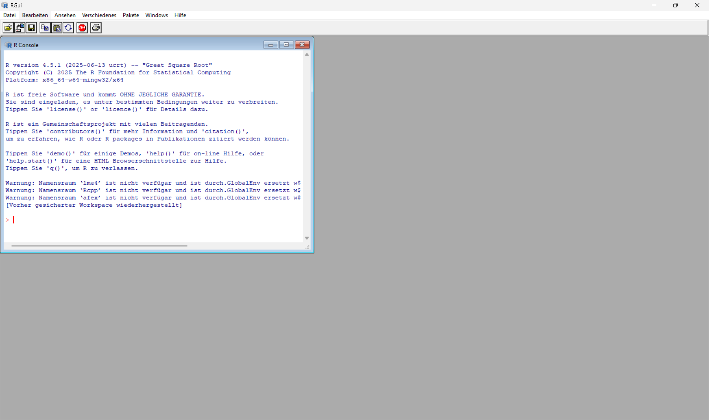{height=250 style="border: 2px solid red;"}
:::

::: column
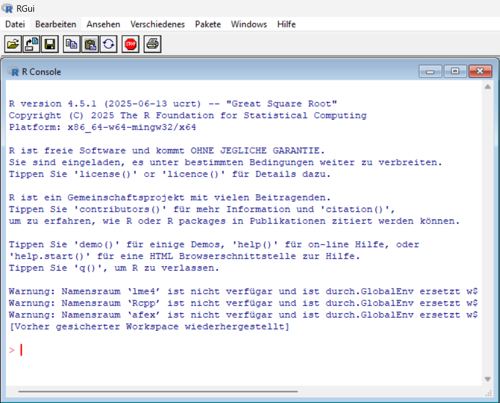{height=250 style="border: 2px solid red;"}
:::
:::

**Was sehen wir hier?**

- ***Linkes Bild***
  - Die „normale" **R-Oberfläche**
    - Sie besteht zunächst nur aus einer ***R Console***
- ***Rechtes Bild***
  - Die **R Console**
    - Hier werden Befehle direkt eingegeben
    - Ergebnisse erscheinen sofort darunter

::: callout-note
# **Hinweis**

Alles, was du in die Konsole eingibst, wird sofort von R ausgeführt. Das Ergebnis siehst du direkt unter der eingegebenen Zeile.

***Beispiel***

- gib `13` ein
- gib `a` ein
- gib `13 + 15` ein
:::

::: callout-caution
**ABER**

Wir brauchen ***R GUI*** nicht, sondern nutzen **RStudio!**
:::

## RStudio – Unser Cockpit 🎛️

Schauen wir uns nun die Oberfläche von **RStudio** an. Startet einfach **RStudio** ***(nicht R GUI!)***. Ihr solltet nun das folgende Bild sehen:

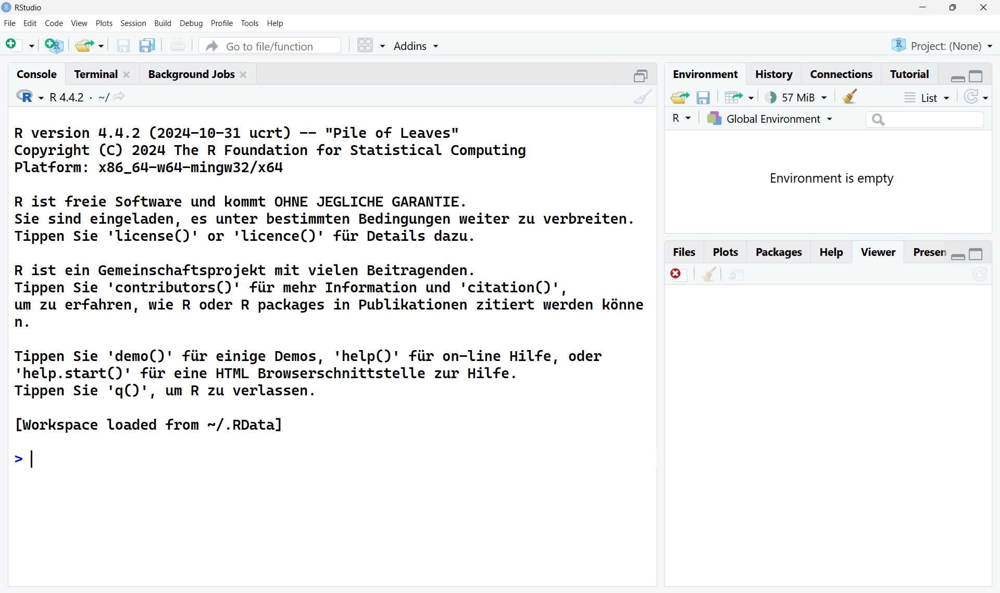{width=100% style="border: 2px solid darkblue;"}

**Wir schauen uns nun die Menü-Leiste von RStudio an:**

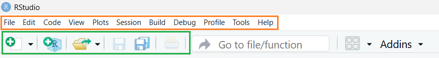{width=100% style="border: 2px solid darkblue;"}

<span style="color: orange; font-weight: bold;">Orange</span> – die Menü-Leiste

In der Menü-Leiste findest du alle wichtigen Funktionen von RStudio übersichtlich nach Themen sortiert. Hier kannst du zum Beispiel Dateien öffnen und speichern, Einstellungen ändern, Code ausführen oder Hilfe aufrufen. *Das Aussehen deines RStudios kannst du auch hier anpassen!*

<span style="color: green; font-weight: bold;">Grün</span> – die Schnellzugriff-Leiste

Die Schnellzugriff-Leiste enthält häufig genutzte Funktionen als Symbole. Damit kannst du z. B. schnell neue Dateien erstellen, Skripte speichern oder Code ausführen, ohne durch Menüs zu klicken.

## Die vier Bereiche von RStudio

RStudio ist in **vier Arbeitsbereiche** (Panes/Paneele) aufgeteilt. Jeder Bereich hat eine eigene Aufgabe. Im ersten Moment siehst du jedoch nur drei Bereiche – ich zeige dir, wie du den vierten bekommst.

::: callout-note
Hierfür gehst du in die **Schnellzugriffs-Leiste** und klickst auf das Symbol ganz links, das **weiße Blatt** mit dem <span style="color: green; font-weight: bold;">**Plus**</span>.

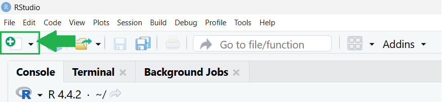{width=100% style="border: 2px solid darkblue;"}

Anschließend öffnet sich ein **Dropdown-Menü** – hier siehst du bereits, was du alles mit ***RStudio*** machen kannst.

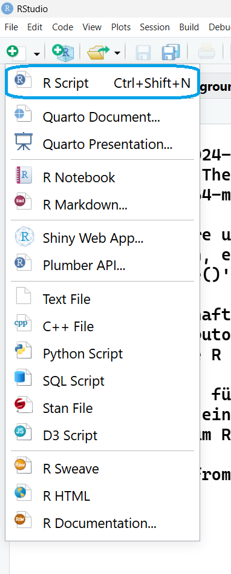{height=600 style="border: 2px solid darkblue;"}

Wir wollen ein neues **R Script erstellen**, daher klicken wir auf diesen Eintrag.

::: callout-note
# Info
Diese Workshopseite wurde übrigens komplett mit RStudio und Quarto Markdown erstellt.
:::
:::

Jetzt sollte dein RStudio so aussehen:

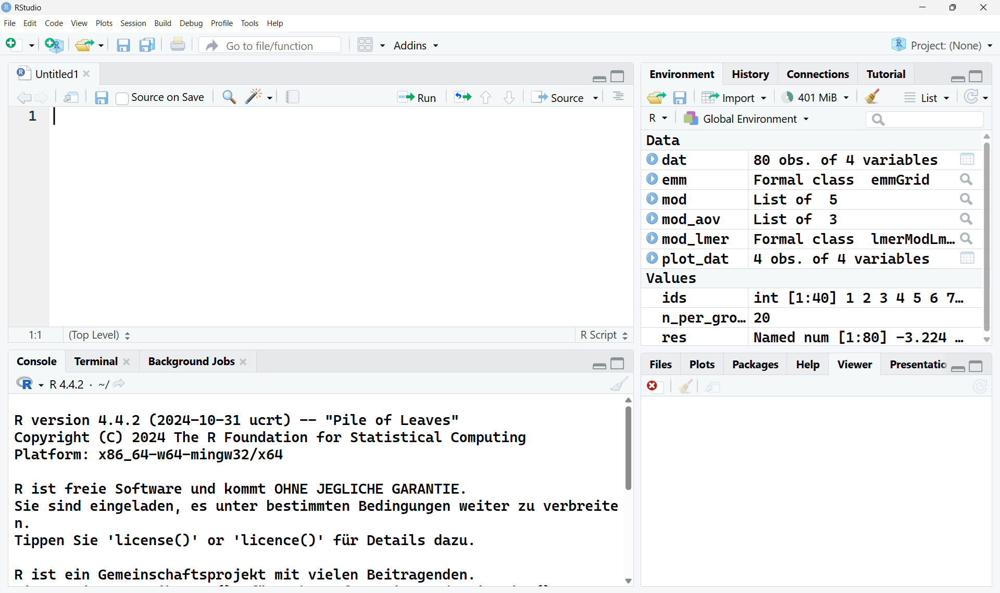{width=100% style="border: 2px solid darkblue;"}

### 🔵 Skript-Editor (oben links)
___
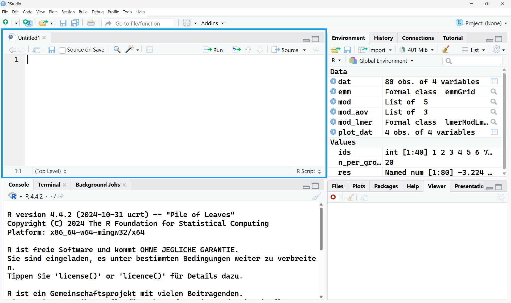{width=100% style="border: 2px solid darkblue;"}

Hier schreibst du deinen **Code** in Skripten.

- Code wird **nicht sofort** ausgeführt
- du kannst ihn speichern, verändern und wiederverwenden
- ideal für sauberes, nachvollziehbares Arbeiten

::: callout-note
👉 **Merke:**  
Alles Wichtige gehört ins **Skript**, nicht nur in die Konsole.
:::


### ⚫ Konsole (unten links)
___
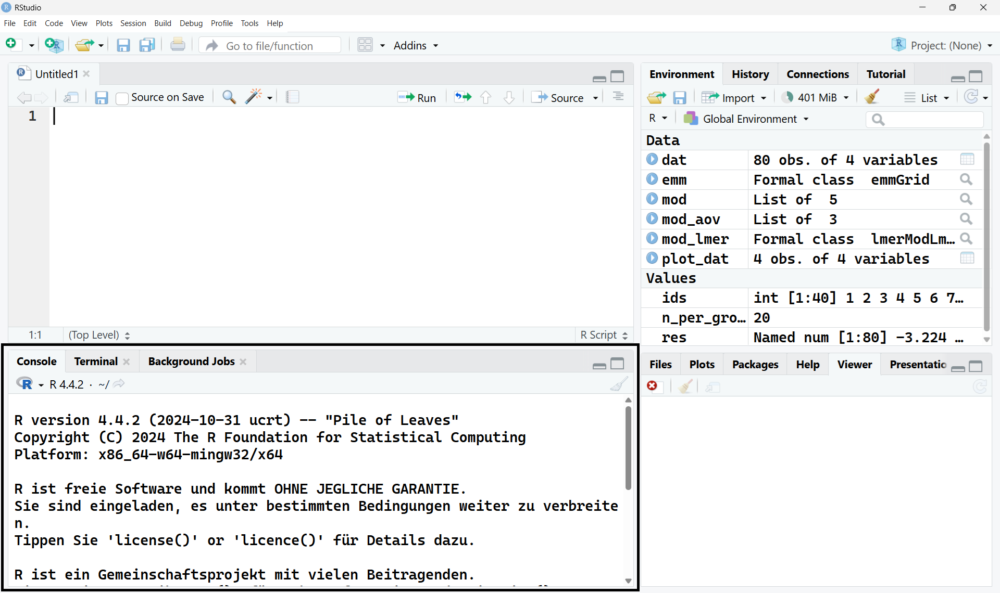{width=100% style="border: 2px solid darkblue;"}

Die ***Konsole*** kennen wir im Grunde schon – es ist dieselbe Konsole wie bei **R GUI**.

- hier führt R Befehle aus
- Ergebnisse erscheinen direkt darunter
- gut zum Ausprobieren und Testen

👉 Code aus dem Skript kann mit **Run** oder **Strg + Enter** ausgeführt werden.


### 🟣 Environment & History (oben rechts)
___
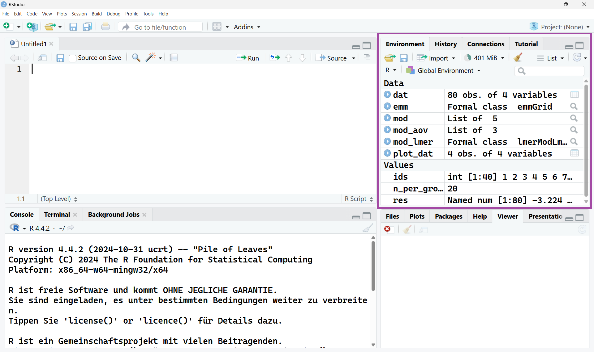{width=100% style="border: 2px solid darkblue;"}

<u>Im **Environment** siehst du:</u>

- alle Objekte, die du erstellt hast
- z. B. Variablen, Daten, Ergebnisse

<u>In der **History** findest du:</u>

- frühere Befehle, die du eingegeben hast

👉 So behältst du den Überblick, was gerade „im Speicher" liegt.


### 🟢 Files, Plots, Packages, Help (unten rechts)
___
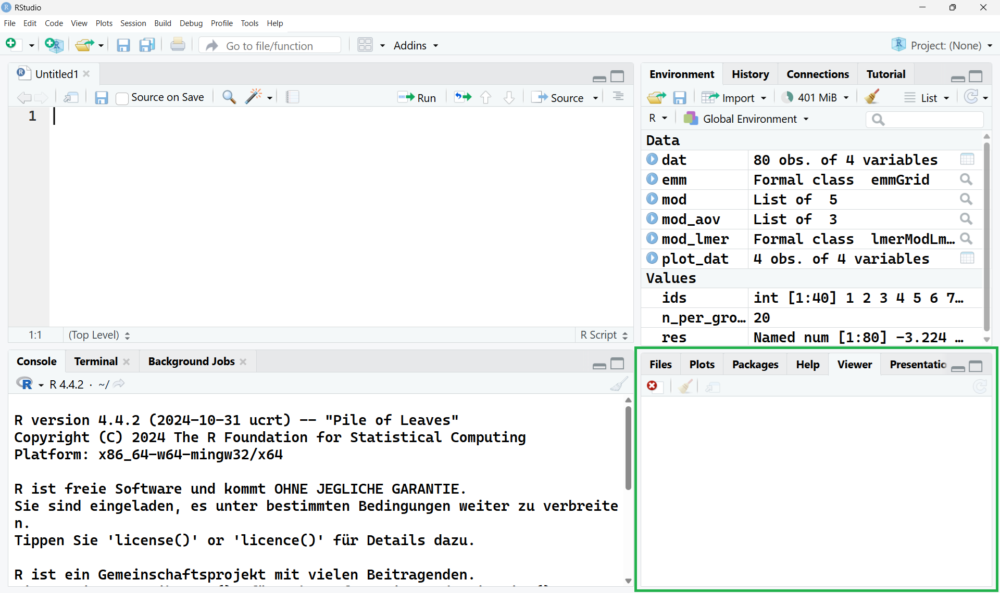{width=100% style="border: 2px solid darkblue;"}

Dieser Bereich zeigt dir:

- **Files**: deine Dateien und Ordner
- **Plots**: Grafiken, die du erzeugst
- **Packages**: installierte Erweiterungen
- **Help**: Hilfeseiten zu Funktionen

👉 Hier findest du fast alles, was R zusätzlich ausgibt – und wo es gespeichert ist.

::: callout-important
Im nächsten Abschnitt legen wir unser erstes **Projekt** an!
:::

# Projekt anlegen
___
Ein Projekt hilft dir, **strukturiert und reproduzierbar** zu arbeiten.

- alle Dateien (Skripte, Daten, Grafiken) liegen an einem festen Ort  
- R weiß immer, **wo es die Dateien findet** (keine kaputten Pfade)
- du kannst deine Arbeit jederzeit schließen und **genau dort weitermachen**
- besonders wichtig für größere Analysen und gemeinsames Arbeiten

👉 **Merke:**  
Ein neues Projekt = ein neuer, sauberer Arbeitskontext.
 
::: callout-warning
**Typischer Anfängerfehler**

Viele arbeiten **ohne Projekt** und laden Dateien „irgendwoher".

Das führt oft zu:

- Fehlermeldungen wie *„file not found"*
- nicht reproduzierbaren Analysen
- Verwirrung, wenn man die Sitzung neu startet

👉 **Gewöhne dir an:**  
Für **jedes Projekt** ein eigenes RStudio-Projekt anzulegen.
:::

### Projekt anlegen – Schritt für Schritt
___
1. Klicke oben auf **File → New Project…** in der Menü-Leiste
2. Wähle **New Directory**
3. Wähle **New Project**
4. Vergib einen **sinnvollen Namen** (z. B. `r_workshop`)
5. Wähle einen Speicherort auf deinem Rechner
6. Klicke auf **Create Project**

::: columns
::: column
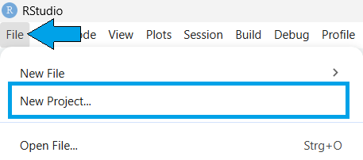{width=100% style="border: 2px solid darkblue;"}
**Schritt 1:**  
*File → New Project…*
:::

::: column
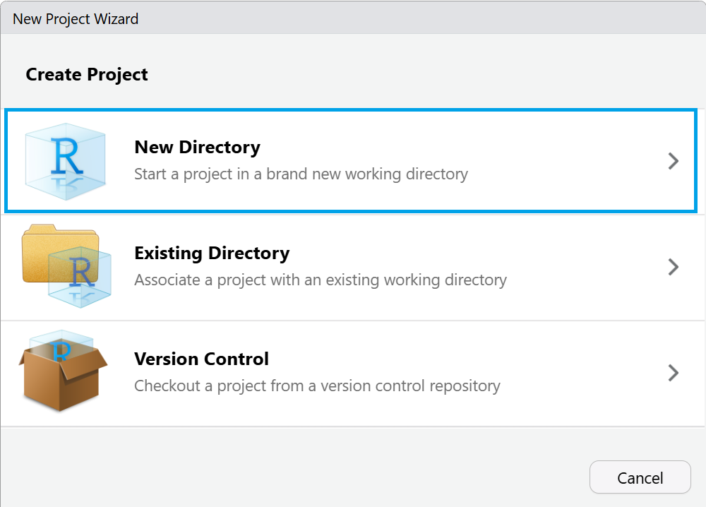{width=100% style="border: 2px solid darkblue;"}
**Schritt 2:**  
*New Directory*
:::
:::

::: columns
::: column
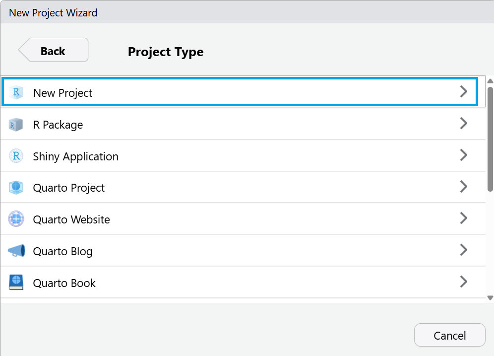{width=100% style="border: 2px solid darkblue;"}
**Schritt 3:**  
*New Project*
:::

::: column
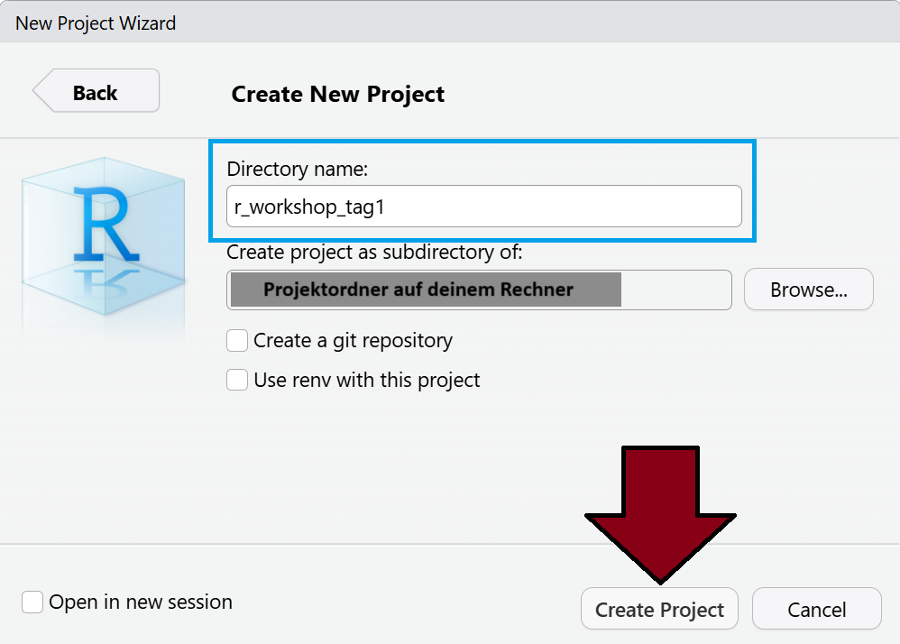{width=100% style="border: 2px solid darkblue;"}
**Schritt 4 bis 6:**  
*Name vergeben, Speicherort wählen & Create Project*
:::
:::


::: callout-tip
👉 **Tipp:**  
Der Projektname sollte **keine Leerzeichen** enthalten  
(z. B. `r_workshop` statt `R Workshop`)
:::

**RStudio startet nun neu – du arbeitest jetzt** ***innerhalb deines Projekts.***


# R Script
___
Nachdem wir ein Projekt angelegt haben, beginnen wir mit dem eigentlichen Arbeiten in einem **R Script**.

Ein Script ist eine Textdatei, in der du deine Befehle sammelst und speicherst.  
So kannst du:

- deine Arbeit nachvollziehen
- Code später wiederverwenden
- Analysen Schritt für Schritt dokumentieren

RStudio bietet viele Möglichkeiten, mit R zu arbeiten.  
Wir starten bewusst **sehr einfach**, um ein Gefühl dafür zu bekommen, wie R reagiert.

::: callout-tip
### **Erinnerung**
Mit **Strg + Enter** wird der Befehl **in der Zeile ausgeführt, in der dein Cursor steht** –  
du musst den Code **nicht markieren** und **nicht auf „Run" klicken**.
:::


## RStudio als Taschenrechner

Zum Einstieg kannst du RStudio wie einen **Taschenrechner** benutzen.

Du gibst einen Befehl ein – R rechnet – und gibt das Ergebnis zurück.  
So lernst du schnell:

- wie Befehle aufgebaut sind
- wie R mit Zahlen umgeht
- dass R immer auf **Eingaben reagiert**

```{r}
#| echo: true

2 + 2
10 / 3
sqrt(49)
```

::: {.callout-warning collapse="true"}
# **Warum ins Skript schreiben?**

Befehle, die du **nur in der Konsole** eingibst, sind schnell wieder weg –  
du musst später mühsam hochscrollen, um sie zu finden.

Schreibst du deine Rechnungen **in ein R Script**, bleiben sie erhalten:

- du kannst sie jederzeit wieder ausführen
- du behältst den Überblick
- deine Arbeit ist nachvollziehbar und reproduzierbar
:::

## Übung

1. Berechne den Ausdruck `((8 + 4)^2 - 10) / 2`.
2. Berechne anschließend `sqrt(196) + 3^3`.
3. Führe **alle Rechnungen**
   - einmal direkt in der **Konsole**
   - und einmal aus einem **Skript**

Beobachte, was gleich ist und was sich unterscheidet.

::: {.callout-tip collapse="true"}
# **Lösung**

```{r}
#| echo: true

# Aufgabe 1
((8 + 4)^2 - 10) / 2

# Aufgabe 2
sqrt(196) + 3^3
```
::: 

::::: {.checkfragen}

:::: {.frage data-richtig="2"}
**Zum Inhalt:** Was ist RStudio?

1. Eine eigene Programmiersprache, die R ersetzt
2. Ein Programm, das die Arbeit mit R erleichtert – eine Art Schreibtisch für R
3. Ein R-Paket für Grafiken
::::

:::: {.frage data-richtig="3"}
**Zur Übung:** Welches Ergebnis liefert `((8 + 4)^2 - 10) / 2`?

1. 62
2. 134
3. 67
4. 77
::::

:::::

::::::::

:::::::: {.modul #modul-2 data-titel="Grundprinzipien von R"}

# Grundprinzipien von R
___
R arbeitet objektorientiert: Alles, was du erzeugst, kann ein Objekt sein und bekommt einen Namen.

```{r}
#| echo: true

x <- 5
y <- c(23, 12, 11, 9, 13)
```

::: callout-note
# **Hinweis**

- `<-` ist der **Zuweisungspfeil**: Er weist den Wert rechts dem Namen links zu.  
- `c()` steht für **combine**: Damit fasst R mehrere Werte zu einem **Vektor** zusammen.  
- `y` ist der **Name des Objekts**. Das Objekt selbst ist ein **Vektor**, der mehrere Zahlen enthält.
:::

## Funktionen verwenden

Funktionen sind **vordefinierte Befehle**, mit denen R etwas für uns erledigt.  
Sie nehmen einen oder mehrere **Eingabewerte** entgegen, führen damit eine bestimmte Operation aus und geben ein **Ergebnis** zurück.

Man kann sich Funktionen wie **Werkzeuge** vorstellen:  
Je nach Aufgabe benutzen wir ein anderes Werkzeug.

In R werden Funktionen immer mit **runden Klammern `()`** aufgerufen.

Im Folgenden verwenden wir einige **grundlegende Funktionen**, die R bereits mitbringt:

```{r}
#| echo: true

sum(y)
mean(y)
sd(y)
median(y)
mad(y)
min(y)
max(y)
range(y)
length(y)
```

::: {.callout-note collapse="true"}
# **Was machen diese Funktionen?**

- `sum()` – berechnet die **Summe** aller Werte  
- `mean()` – berechnet den **Mittelwert**  
- `sd()` – berechnet die **Standardabweichung**  
- `median()` – gibt den **Median** zurück  
- `mad()` – berechnet die **mittlere absolute Abweichung**  
- `range()` – gibt **kleinsten und größten Wert** aus  
- `min()` – kleinster Wert  
- `max()` – größter Wert  
- `length()` – Anzahl der Werte

Es gibt eine Vielzahl **Base R-Funktionen** – erkunde sie gerne!
:::

Funktionen können nicht nur einzeln, sondern auch **miteinander kombiniert** werden.  
Das Ergebnis einer Funktion kann dabei **direkt als Eingabe** für eine andere dienen.

```{r}
#| echo: true

sqrt(mean(y))
max(y) - min(y)
```

In der nächsten Übung nutzen wir diese Grundfunktionen,  
um eigene Kennwerte zu berechnen und die Ergebnisse **als Objekte zu speichern**.

## Übung

Nutze den Vektor `y` und berechne folgende Kennwerte:

1. Den **Standardfehler des Mittelwerts**  
2. Die **Varianz**  
3. Die **z-standardisierten Werte** (z-Werte)  
4. Das **95%-Konfidenzintervall** (KI) für den Mittelwert

Speichere alle Ergebnisse als eigene Objekte, z. B.: `se_y`, `var_y`, `z_y`, `ci_y`.


::: {.callout-tip collapse="true"}
# **Tipp: Formeln für die Berechnung**

Du darfst dir für die Berechnung **Hilfsobjekte** anlegen.

:::{.panel-tabset}

# **Standardfehler des Mittelwerts**

$$
SE = \frac{sd(x)}{\sqrt{n}}
$$

- $sd$ = Standardabweichung 
- $n$ = Anzahl der Werte  

# **Varianz (Stichprobe)**

$$
\text{Var} = \frac{1}{n - 1} \sum (x - \bar{x})^2
$$

- $\bar{x}$ = Mittelwert der Daten  
- $\sum$ = Summe über alle Beobachtungen  

# **z-Standardisierung**

$$
z = \frac{x - \bar{x}}{sd(x)}
$$

# **95%-Konfidenzintervall des Mittelwerts**

$$
\bar{x} \pm t_{0.975,\,n-1} \cdot SE
$$

- $t_{0.975,\,n-1}$ = kritischer t-Wert für ein **95 %-Konfidenzintervall**. In R: `qt(0.975, df = n - 1)`
- $\pm$ = untere und obere Grenze des Intervalls
:::
:::

::: {.callout-tip collapse="true"}
# **Lösung**

:::{.panel-tabset}
# Hilfsobjekte
```{r}
#| echo: true

n <- length(y)   # Anzahl der Werte
m <- mean(y)     # Mittelwert
s <- sd(y)       # Standardabweichung
```
# 1. Standardfehler
```{r}
#| echo: true
se_y <- s / sqrt(n)
se_y
```
# 2. Varianz
```{r}
#| echo: true
var_y <- sum((y - m)^2) / (n - 1)
var_y
```
# 3. z-Werte
```{r}
#| echo: true
z_y <- (y - m) / s
z_y
```
# 4. Konfidenzintervall
```{r}
#| echo: true
t_crit <- qt(0.975, df = n - 1)

ci_y <- c(
  lower = m - t_crit * se_y,
  upper = m + t_crit * se_y
)

ci_y
```
:::
:::


::: callout-warning
# **Häufige Fehler**

- Funktion falsch geschrieben: `Mean(y)` statt `mean(y)`  
- Klammern vergessen: `mean y` statt `mean(y)`  
- `<-` vergessen oder `=` inkonsistent verwendet  
- Im falschen Fenster tippen (Konsole statt Skript oder umgekehrt)
:::

::::: {.checkfragen}

:::: {.frage data-richtig="2"}
**Zum Inhalt:** Was macht der Zuweisungspfeil `<-`?

1. Er vergleicht zwei Werte miteinander
2. Er weist den Wert rechts dem Namen links zu
3. Er fasst mehrere Werte zu einem Vektor zusammen
::::

:::: {.frage data-richtig="1"}
**Zur Übung:** Wie berechnest du den Standardfehler des Mittelwerts von `y`?

1. `sd(y) / sqrt(length(y))`
2. `sd(y) / length(y)`
3. `sum((y - mean(y))^2) / (length(y) - 1)`
4. `(y - mean(y)) / sd(y)`
::::

:::::

::::::::

:::::::: {.modul #modul-3 data-titel="Datentypen & Datenstrukturen"}

## Datentypen & Datenstrukturen

In R ist es wichtig zu wissen, **was für eine Art von Daten** wir vor uns haben  
und **wie diese Daten organisiert sind**.

Deshalb unterscheiden wir zwischen **Datentypen** und **Datenstrukturen**.

Beides bestimmt, wie wir mit Daten rechnen, sie verändern und analysieren können.

### Wichtige Datentypen
___
Datentypen legen fest, **welche Art von Werten** in einem Objekt gespeichert ist.  
R behandelt Zahlen, Text und logische Werte unterschiedlich – je nach Datentyp.

Der Datentyp ist wichtig, weil er bestimmt,

- welche Berechnungen möglich sind
- wie R die Werte interpretiert
- welche Funktionen sinnvoll angewendet werden können

::: callout-note
# **Datentypen im Überblick**

- `numeric` / `double`  
  Zahlen mit Dezimalstellen, z. B. `3.14` oder `-7.5`.  
  Wird für die meisten Berechnungen verwendet.

- `integer`  
  Ganze Zahlen ohne Dezimalstellen, z. B. `1L` oder `42L`.  
  Kommt seltener vor, ist aber wichtig bei Zählvariablen.

- `character`  
  Textwerte, z. B. `"Anna"` oder `"Deutschland"`.  
  Mit Text kann man **nicht rechnen**.

- `logical`  
  Logische Werte: `TRUE` oder `FALSE`.  
  Wird häufig bei Bedingungen oder Filtern genutzt.

- `factor`  
  Kategorische Daten mit festen Ausprägungen, z. B. Geschlecht oder Schulabschluss.
:::


### Wichtige Datenstrukturen
___
Datenstrukturen beschreiben, **wie mehrere Werte in R zusammengefasst und organisiert** sind.  
Sie legen fest, ob Daten einzeln, als einfache Reihe oder als Tabelle gespeichert werden.

::: callout-note
# **Datenstrukturen im Überblick**

- **Vektor**  
  Eine geordnete Sammlung von Werten **gleichen Datentyps**.  
  Grundlage für fast alle anderen Datenstrukturen in R.

- **Matrix**  
  Eine rechteckige Tabelle aus Werten **gleichen Datentyps** (meist Zahlen).  
  Wird vor allem für mathematische und statistische Berechnungen verwendet.

- **Data Frame / tibble**  
  Eine Tabelle mit Zeilen (**Fälle**) und Spalten (**Variablen**).  
  Standardformat für Datensätze in der empirischen Forschung.
:::

Datenstrukturen in R bauen konzeptionell aufeinander auf. Am Anfang steht der **Vektor**:  

- Ein Vektor ist eine einfache, geordnete Reihe von Werten gleichen Datentyps.

Aus Vektoren lassen sich **Matrizen** bilden:

- Eine Matrix ist eine Sammlung mehrerer gleich langer Vektoren, die rechteckig angeordnet sind.

Ein **Data Frame** geht einen Schritt weiter:

- Auch hier bestehen die Spalten aus Vektoren – die Spalten dürfen aber **unterschiedliche Datentypen** haben.

So lassen sich reale Datensätze mit **Zahlen, Text und Kategorien** in einer Tabelle abbilden.

::: callout-warning
# **Wichtig**

Die Datenstrukturen bauen **konzeptionell** aufeinander auf,  
werden in der Praxis aber **nicht automatisch ineinander umgewandelt**.
:::

### Welchen Datentyp oder welche Datenstruktur hat mein Objekt?
___
In R können wir jederzeit überprüfen, **was für eine Art von Objekt** wir im Environment haben. Das ist besonders hilfreich, wenn wir mit vielen Objekten arbeiten oder unsicher sind, wie R ein Objekt interpretiert.

::: callout-tip
# **Grundlegende Befehle im Überblick**

- `class(x)` – gibt eine **allgemeine Einordnung** des Objekts zurück
  - `typeof(x)` – detaillierter als `class()`, zeigt **wie R das Objekt intern speichert**
- `str(x)` – gibt einen **Überblick über Aufbau und Inhalt** eines Objekts

Für **Funktionen**:
- `?mean` – öffnet die **Hilfeseite** zur Funktion `mean()` (Beschreibung, Argumente, Beispiele)
:::

Im Folgenden betrachten wir unsere zuvor erstellten Objekte `x` und `y` genauer:

```{r}
#| echo: true

class(x)
class(y)

typeof(x)
typeof(y)

str(x)
str(y)
```


## Übung

Im bisherigen Verlauf haben wir mehrere **Objekte und Hilfsobjekte** erstellt.

1. Überprüfe für jedes dieser Objekte den **Datentyp** und die **Datenstruktur**.
2. Nutze dafür die Befehle `class()`, `typeof()` und `str()`.
3. Überlege:
   - Welche Objekte sind **einzelne Werte**?  
   - Welche Objekte sind **Vektoren**?

::: {.callout-tip collapse="true"}
# **Lösung**

:::{.panel-tabset}

# Mittelwert
```{r}
#| echo: true
class(m)
typeof(m)
str(m)
```

# Anzahl der Werte
```{r}
#| echo: true
class(n)
typeof(n)
str(n)
```
# Standardabweichung
```{r}
#| echo: true
class(s)
typeof(s)
str(s)
```
# Standardfehler
```{r}
#| echo: true
class(se_y)
typeof(se_y)
str(se_y)
```
# Varianz
```{r}
#| echo: true
class(var_y)
typeof(var_y)
str(var_y)
```
# z-Werte
```{r}
#| echo: true
class(z_y)
typeof(z_y)
str(z_y)
```
# Konfidenzintervall
```{r}
#| echo: true
class(ci_y)
typeof(ci_y)
str(ci_y)
```
:::
:::

::: callout-tip
# **Faustregel: Ein Objekt in R verstehen**
1. `class()` → Welche **Art von Objekt** ist es?
2. `typeof()` → Wie wird das Objekt **intern gespeichert**?
3. `str()` → Wie ist das Objekt **aufgebaut** und welche Inhalte hat es?
:::

::::: {.checkfragen}

:::: {.frage data-richtig="2"}
**Zum Inhalt:** Was unterscheidet einen Data Frame von einer Matrix?

1. Ein Data Frame kann nur Zahlen enthalten
2. Die Spalten eines Data Frames dürfen unterschiedliche Datentypen haben
3. Eine Matrix hat keine Zeilen
4. Es gibt keinen Unterschied
::::

:::: {.frage data-richtig="3"}
**Zur Übung:** Welche Objekte aus der Übung sind Vektoren mit mehreren Werten?

1. `m` und `n`
2. `se_y` und `var_y`
3. `z_y` und `ci_y`
4. alle Objekte
::::

:::::

::::::::

:::::::: {.modul #modul-4 data-titel="Einen Datensatz erstellen & Pakete"}

## Einen ersten Datensatz in R erstellen

Bisher haben wir mit einzelnen Objekten und Vektoren gearbeitet. In der Praxis bestehen Datensätze jedoch aus **mehreren Variablen**, die gemeinsam eine Gruppe von Fällen beschreiben.

Im nächsten Schritt erstellen wir mehrere Vektoren (z. B. Alter, Geschlecht oder Körpergröße) und führen sie zu einem **kleinen Datensatz** zusammen.

Dabei lernst du,
- wie mehrere Vektoren sinnvoll angelegt werden und  
- wie aus einzelnen Variablen eine tabellarische Struktur entsteht.

Wir legen nun unsere neuen Vektoren (= **Variablen**) an:

```{r}
#| echo: true

# Alter
age <- c(23, 29, 35, 41, 27, 33)

# Geschlecht
gender <- c("female", "male", "female", "male", "female", "male")

# Haarfarbe
hair_color <- c("brown", "blonde", "black", "brown", "red", "black")

# Körpergröße in cm
height_cm <- c(165, 180, 172, 178, 160, 185)

# Gewicht in kg
weight_kg <- c(60, 82, 70, 88, 55, 90)

# Beruf
occupation <- c(
  "student",
  "engineer",
  "teacher",
  "manager",
  "student",
  "researcher"
)
```

Jeder dieser Vektoren stellt eine **Variable** dar.  
Die einzelnen Werte gehören jeweils **zur gleichen Person** – also zur gleichen Zeile im späteren Datensatz.

::: callout-important
# Wichtig 
Alle Vektoren müssen **die gleiche Länge** haben.

Überprüfe das!
:::

Im nächsten Schritt fassen wir die einzelnen Variablen zu einem **gemeinsamen Datensatz** zusammen.  
Dabei verwenden wir zunächst **Base R**, also Funktionen, die ohne zusätzliche Pakete verfügbar sind.

```{r}
#| echo: true

data <- data.frame(
  age        = age,
  gender     = gender,
  hair_color = hair_color,
  height_cm  = height_cm,
  weight_kg  = weight_kg,
  occupation = occupation
)

data
```

::: callout-caution
# Achtung

Aufbau der Funktion `data.frame()`:

`data.frame(name1 = name2)`

- `name1` = Spaltenname im Datensatz
- `name2` = Objektname aus dem Environment
:::

Die einzelnen Vektoren sind nun zu einem **Datensatz** zusammengeführt worden:

- jede **Spalte** ist eine Variable  
- jede **Zeile** ist ein Fall (eine Person)

`data.frame()` ist die klassische Tabellenstruktur in Base R  
und bildet die Grundlage für viele weitere Analyseschritte.

::: callout-note
# **Erinnerung**

Auch ein einzelner Wert ist in R ein **Vektor der Länge 1**. Mit der `c()`-Funktion können wir einzelne Werte zu einem Vektor zusammenfassen.
:::


## Übung

Bisher haben wir einen Datensatz mit sechs Variablen erstellt. Erstelle nun zwei weitere **Variablen** und füge sie zum Datensatz hinzu. Nenne die eine Variable `numbers` und die andere `chars`.

- `numbers` sollen zufällige Zahlen sein, die du dir ausdenkst
- `chars` sollen einfach Namen sein, die dir einfallen

::: {.callout-tip collapse="true"}

# **Lösung**

```{r}
#| echo: true

numbers <- c(12, 5, 17, 6, 75, 22)

chars <- c("Anna", "Alex", "Beate", "Bobby", "Christina", "Chester")

data <- data.frame(
  age        = age,
  gender     = gender,
  hair_color = hair_color,
  height_cm  = height_cm,
  weight_kg  = weight_kg,
  occupation = occupation,
  nmbrs      = numbers,
  chars      = chars
)
```
:::

::: callout-warning
# **Typische Fehler beim Erstellen eines Data Frames**

- **Komma vergessen oder zu viel gesetzt**  
  → führt oft zu unerwarteten Fehlermeldungen

- **Falscher Objektname**  
  → R unterscheidet zwischen Groß- und Kleinschreibung (`Age` ≠ `age`)

- **Unterschiedliche Längen der Vektoren**  
  → alle Variablen müssen **gleich viele Werte** haben
:::

## Exkurs: Pakete

Pakete sind **Erweiterungen von R**.  
Sie enthalten zusätzliche Funktionen, Datensätze und Dokumentationen,  
die bestimmte Aufgaben erleichtern oder überhaupt erst möglich machen.

R bringt bereits viele grundlegende Funktionen mit (Base R).  
Für komplexere oder spezialisierte Aufgaben greifen wir jedoch häufig auf **Pakete** zurück.

### Pakete installieren
___
Bevor wir ein Paket nutzen können, müssen wir es **einmal installieren**.  
Die Installation erfolgt über das Internet und wird lokal auf dem Rechner gespeichert.

```{r}
#| echo: true
#| eval: false

install.packages("tidyverse")
install.packages("psych")
```

::: callout-warning
# **Wichtig**

`install.packages()` muss **nur einmal** ausgeführt werden.  
Danach ist das Paket dauerhaft auf deinem Rechner verfügbar.
:::

### Paket laden
___
Nach der Installation müssen Pakete **in jeder neuen R-Sitzung geladen** werden,
damit ihre Funktionen zur Verfügung stehen.

```{r}
#| echo: true
#| eval: false

library(tidyverse)
library(psych)
```

::: callout-tip
# **Merksatz**

- `install.packages()` → einmal installieren  
- `library()` → in jeder Sitzung laden
:::

### Das `tidyverse`
___
Das **`tidyverse`** ist eine Sammlung mehrerer Pakete,  
die besonders für **Datenaufbereitung, Analyse und Visualisierung** entwickelt wurden.

Es bietet:

- gut lesbaren Code  
- einheitliche Funktionsnamen  
- komfortable Werkzeuge für Data Frames

::: callout-tip
Typische `tidyverse`-Pakete sind zum Beispiel:

- `dplyr` (Datenaufbereitung)
- `ggplot2` (Visualisierung)
- `readr` (Datenimport)
:::

Wir werden das `tidyverse` später als **Alternative zu Base R** nutzen.

### Das `psych`-Paket
___
Das Paket **`psych`** wird häufig in den Sozial- und Verhaltenswissenschaften verwendet.

Es enthält unter anderem:

- deskriptive Statistiken
- Skalenanalysen
- psychometrische Kennwerte

::: callout-note
`psych` ergänzt Base R um viele Funktionen,
die in der empirischen Forschung regelmäßig benötigt werden.
:::

::::: {.checkfragen}

:::: {.frage data-richtig="1"}
**Zum Inhalt:** Wie oft musst du ein Paket installieren und wie oft laden?

1. `install.packages()` einmal, `library()` in jeder neuen R-Sitzung
2. Beides nur einmal
3. Beides in jeder neuen R-Sitzung
4. `install.packages()` in jeder Sitzung, `library()` nur einmal
::::

:::: {.frage data-richtig="2"}
**Zur Übung:** Was musst du beachten, wenn du `numbers` und `chars` zum Datensatz hinzufügst?

1. Die Vektoren müssen Zahlen enthalten
2. Beide Vektoren müssen gleich viele Werte haben wie die anderen Variablen
3. Die Variablennamen müssen großgeschrieben sein
4. Nichts – R gleicht unterschiedliche Längen automatisch an
::::

:::::

::::::::

:::::::: {.modul #modul-5 data-titel="Datenimport & Datenaufbereitung"}

## Datenimport

Bisher haben wir Datensätze selbst erstellt, um zu verstehen,  
wie Daten in R **strukturiert** sind (Vektoren, Data Frames, Variablen).

In der Praxis müssen wir Datensätze jedoch **nicht von Hand anlegen**.  
Häufig stammen Daten aus externen Quellen, zum Beispiel aus:

- Online-Befragungstools (z. B. SoSci Survey)
- Excel-Tabellen
- Statistiksoftware wie SPSS
- Forschungsprojekten oder Repositorien

Diese Daten werden meist über eine **Export-Funktion** als Datei bereitgestellt (z. B. CSV oder Excel) und anschließend in R **importiert**.

::: callout-note
# **Typische Datenformate**

- **CSV** (`.csv`) – sehr verbreitet, einfach, textbasiert  
- **Excel** (`.xlsx`) – häufig in der Praxis  
- **SPSS** (`.sav`) – vor allem in den Sozialwissenschaften
:::

Beim Importieren können verschiedene **Hürden** auftreten.  
Diese sind normal und gehören zur Arbeit mit realen Datensätzen dazu.

::: callout-warning
# **Typische Probleme beim Datenimport**

- Datei wird nicht gefunden (falscher **Pfad**)  
- Falsches **Trennzeichen** (Komma vs. Semikolon)  
- Umlaute oder Sonderzeichen werden falsch angezeigt (**Encoding**)  
- Variablen werden als Text statt als Zahl erkannt  
- Fehlende Werte sind unterschiedlich kodiert (z. B. leer, `-99`, `999`)
:::

Um den Datenimport möglichst übersichtlich und zuverlässig zu gestalten,  
verwenden wir Funktionen aus dem **`tidyverse`**.

::: callout-tip
# **Einordnung**

Wir haben bewusst zuerst mit **Base R** gearbeitet,  
um die grundlegenden Strukturen zu verstehen.

Jetzt nutzen wir das `tidyverse` als **komfortablere Alternative**  
für reale Daten und typische Workflows.
:::

Für die folgenden Schritte arbeiten wir mit einem **vorgegebenen Datensatz**.

Bitte lade den Datensatz herunter und speichere ihn **in deinem Projektordner**, zum Beispiel im Unterordner `data/`.

➡️ **[Workshop-Datensatz herunterladen (CSV)](../ws1/assets/data/datensatz_workshop.csv)**  
➡️ **[Workshop-Datensatz herunterladen (SPSS)](../ws1/assets/data/spss_datensatz_workshop.sav)**

Hier kannst du das **Codebuch** zum Datensatz herunterladen, für einen besseren Überblick über die Variablen im Datensatz.

➡️ **[Codebuch Workshop-Datensatz (PDF)](../ws1/assets/data/codebook_workshop_datensatz.pdf)**

::: callout-warning
# **Wichtig**

Achte darauf, die Datei **nicht irgendwo auf dem Rechner**, sondern **im Projektordner** zu speichern.  
Nur so funktionieren die folgenden Import-Befehle ohne Probleme.
:::

Jetzt importieren wir die Daten:

```{r}
#| echo: true
#| warning: false

library(tidyverse)
library(haven)

df_csv  <- read_csv("assets/data/datensatz_workshop.csv")
df_spss <- read_sav("assets/data/spss_datensatz_workshop.sav")
```

::: callout-note
# **Hinweis**

Was fällt dir auf, wenn du die **beiden Datensätze** vergleichst?
:::

::: callout-warning
# **Typische Probleme & Lösungen**

| Problem             | Mögliche Ursache   | Mögliche Lösung                               |
|--------------------|--------------------|-----------------------------------------------|
| `cannot open file` | falscher Pfad      | Projektordner prüfen, Dateipfad anpassen      |
| Umlaute „kaputt"   | Encoding           | `locale = locale(encoding = "UTF-8")` testen |
| alles `character`  | Typ falsch erkannt | nachträglich mit `mutate()` umwandeln         |
:::

## Datenaufbereitung

Nachdem wir den Datensatz erfolgreich importiert haben, beginnt ein zentraler Schritt der Datenanalyse: die **Datenaufbereitung**.

Daten liegen in der Praxis selten sofort in der Form vor, in der sie analysiert werden können. Häufig müssen Variablen ausgewählt, Fälle gefiltert, Werte umkodiert oder neue Variablen erstellt werden.

Für diese Arbeitsschritte verwenden wir das Paket **dplyr**.

### Überblick Datensatz
___
Bevor wir Daten aufbereiten oder verändern, sollten wir uns immer zuerst einen **Überblick** verschaffen.

So können wir prüfen:
- ob die Daten korrekt importiert wurden
- welche Variablen enthalten sind
- welche Datentypen vorliegen
- ob es offensichtliche Auffälligkeiten gibt

#### Schneller Überblick
___

```{r}
#| results: hide
summary(df_csv)
summary(df_spss)
```

::: {.callout-tip collapse="true"}
# **Output**

```{r}
#| code-fold: true
summary(df_csv)
summary(df_spss)
```
:::

`summary()` gibt uns eine erste **Zusammenfassung der Variablen** (z. B. Min/Max-Werte, Mittelwerte, Häufigkeiten). Es wirkt jedoch schnell unübersichtlich – daher verwenden wir **`glimpse()`**.

```{r}
#| results: hide
glimpse(df_csv)
glimpse(df_spss)
```

::: {.callout-tip collapse="true"}
# **Output**
```{r}
#| code-fold: true
glimpse(df_csv)
glimpse(df_spss)
```
:::

### Exkurs: Datensatzstruktur
___
Bevor wir mit der Datenaufbereitung weitermachen, schauen wir uns an, **wie ein Datensatz in R grundsätzlich aufgebaut ist** und wie wir auf einzelne Variablen zugreifen können.

Ein Datensatz (Data Frame) ist in R eine **Sammlung von Variablen**, die jeweils als Spalten organisiert sind.

::: {.callout-tip collapse="true"}
# **Objekte entfernen**

Einzelne oder mehrere Objekte lassen sich mit `rm()` aus dem Environment entfernen.

```{r}
#| echo: true
#| eval: false

rm(x)

# Mehrere Objekte auf einmal
rm(x, y, m, s)
```
:::

#### Zugriff auf Variablen mit **`$`**
___
In Base R greifen wir auf einzelne Variablen eines Datensatzes mit dem **Dollar-Zeichen `$`** zu.

Dafür schauen wir uns unser Environment mit den Datensätzen an.

___

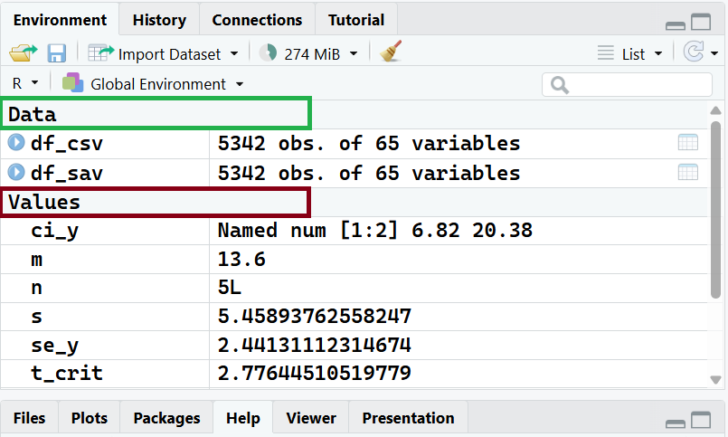{width=100% style="border: 2px solid darkblue;"}

Wir sehen, dass **RStudio** direkt zwischen <span style="color: darkred; font-weight: bold;">Values (einzelne Werte)</span> und <span style="color: green; font-weight: bold;">Data (Datensätze, Tabellen und andere Objekte)</span> unterscheiden kann.

___

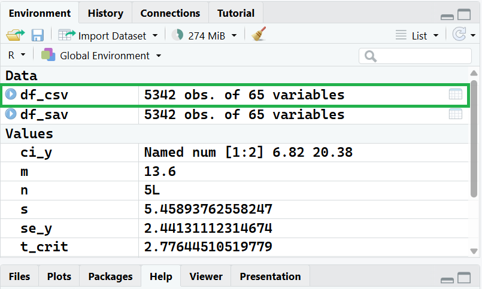{width=100% style="border: 2px solid darkblue;"}

Schauen wir uns unser Datensatz-Objekt genauer an. <span style="color: green; font-weight: bold;">Klicke</span> einfach auf `df_csv` – neben deinem Skript sollte sich nun der Datensatz öffnen.

___

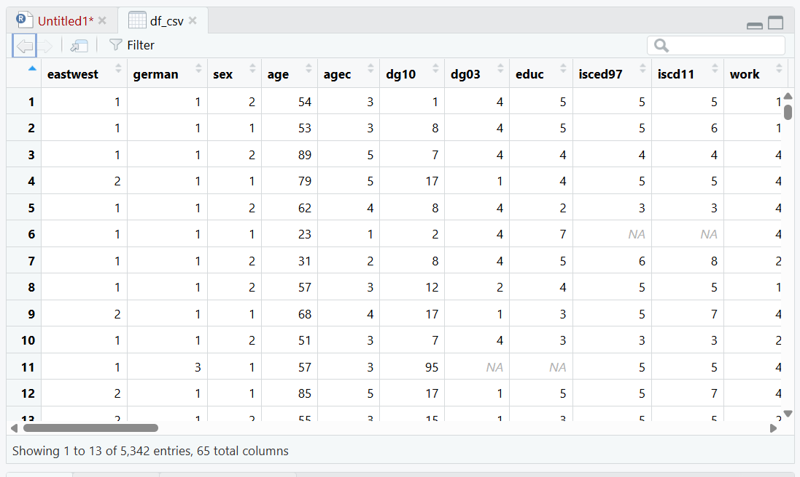{width=100% style="border: 2px solid darkblue;"}

Mit **`View(df_csv)`** kämen wir zum selben Ergebnis. Jetzt kannst du den Datensatz im Detail anschauen.

___

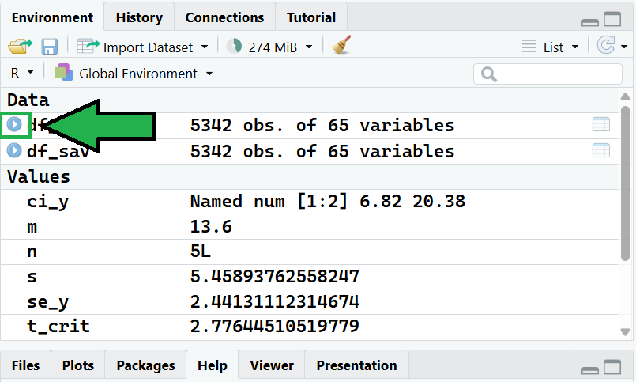{width=100% style="border: 2px solid darkblue;"}

Zurück zum Environment! Mit einem <span style="color: green; font-weight: bold;">Klick</span> auf den blauen Pfeil neben dem Objektnamen öffnest du ein Dropdown mit mehr Informationen – Struktur und Inhalte des Objekts.

___

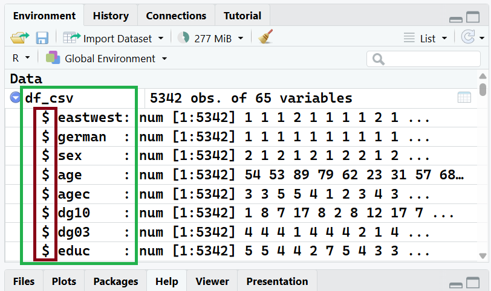{width=100% style="border: 2px solid darkblue;"}

Wir sehen einen logischen Aufbau: <span style="color: green; font-weight: bold;">der Objektname als übergeordnete Struktur</span> und die Variablen als untergeordnete Ebene. Getrennt werden diese zwei Ebenen durch das **`$`**.

___

Der Zugriff auf eine Variable folgt dieser Logik:

1. Erst den Objektnamen eintippen → **`df_csv`**
2. Dann die untere Ebene „aufmachen" → **`$`**
3. Dann den **Variablennamen** eintippen → **`age`**

```{r}
#| echo: true
#| eval: false

df_csv$age
```

Im Output sollten nun alle Altersangaben der teilnehmenden Personen als Vektor erscheinen.


## Übung

Berechne das **Durchschnittsalter** (Mean) und die **Standardabweichung** (SD) des Alters.

::: {.callout-tip collapse="true"}
# **Lösung**

::: {.panel-tabset}

# Alternative 1

```{r}
#| echo: true

mean(df_csv$age, na.rm = TRUE)
sd(df_csv$age, na.rm = TRUE)
```

# Alternative 2

```{r}
#| echo: true
#| warning: false

library(psych)
describe(df_csv$age)
```
:::

:::


### Einführung dplyr
___
`dplyr` ist Teil des **`tidyverse`** und bietet Funktionen,  
mit denen sich Datensätze **lesbar, konsistent und effizient** bearbeiten lassen.

Der Fokus liegt auf:
- klarer, gut nachvollziehbarer Syntax  
- schrittweisem Arbeiten  
- einer einheitlichen „Grammatik" für Datenmanipulation

::: callout-important
# Wichtigste Funktionen

- `select()` – Variablen auswählen  
- `filter()` – Fälle auswählen  
- `mutate()` – neue Variablen erstellen  
- `arrange()` – sortieren  
- `rename()` – Variablen umbenennen
:::

Bevor wir mehrere Schritte kombinieren, schauen wir uns ein **einzelnes, einfaches Beispiel** an:

```{r}
#| echo: true

select(df_csv, age, sex)
```

`select()` wählt Variablen aus und gibt einen neuen Datensatz zurück (`tibble` fungiert dabei genauso wie ein Data Frame).

::: callout-caution
# **Achtung**

Ohne eine **Zuweisung** wird **kein neues Objekt** erstellt!

```{r}
#| echo: true

df_2var <- select(df_csv, age, sex)
df_2var
```
:::

Die Datenaufbereitung besteht meistens aus **mehreren Schritten:**

- Variablen auswählen
- Fälle filtern
- neue Variablen erstellen
- Variablen umbenennen

Wir wählen nun unsere Variablen aus und filtern gleichzeitig: Wir wollen alle Personen **ab 30 Jahren** behalten.

:::{.panel-tabset}

# Alternative 1
```{r}
#| echo: true

df_2var <- select(df_csv, age, sex)
df_2var
```

# Alternative 2
```{r}
#| echo: true

df_2var <- filter(select(df_csv, age, sex), age >= 30)
df_2var
```
:::

**Alternative 2** wirkt auf den ersten Blick effizienter, ist aber schwieriger zu lesen – besonders wenn viele Schritte folgen.

Auch dafür gibt es in R eine elegante Lösung: **Pipes**.

::::: {.checkfragen}

:::: {.frage data-richtig="2"}
**Zum Inhalt:** Was macht `filter()`?

1. Variablen (Spalten) auswählen
2. Fälle (Zeilen) auswählen
3. Neue Variablen erstellen
4. Den Datensatz sortieren
::::

:::: {.frage data-richtig="3"}
**Zur Übung:** Wie berechnest du das Durchschnittsalter, wenn im Datensatz fehlende Werte vorkommen?

1. `mean(age)`
2. `mean(df_csv, age)`
3. `mean(df_csv$age, na.rm = TRUE)`
4. `df_csv$mean(age)`
::::

:::::

::::::::

:::::::: {.modul #modul-6 data-titel="Pipes"}

## Pipes

Pipes in R sind ein Operator (`%>%` oder `|>`), mit dem das Ergebnis **eines Schritts direkt** an den **nächsten Befehl weitergereicht** wird, ohne Zwischenergebnisse extra zu speichern. Dadurch lassen sich **Datenverarbeitungsschritte** wie in einer Kette lesen – der Code wird kürzer und übersichtlicher.

Man kann sich Pipes vorstellen wie die Röhren aus Super Mario:

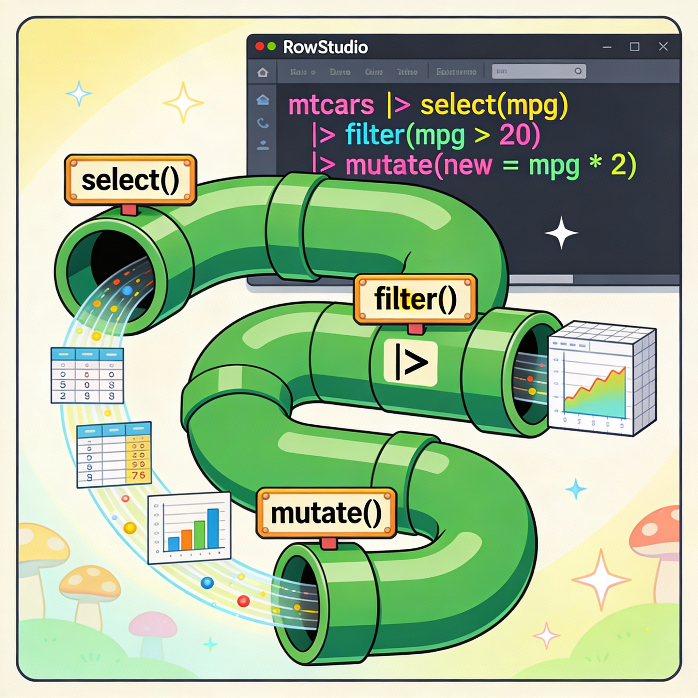{width=100% style="border: 2px solid darkblue;"}

```{r}
#| echo: true

df_2var <- df_csv |>
  select(age, sex) |>
  filter(age >= 30)

df_2var
```

Die Struktur ist klar und wir müssen den Befehlen innerhalb der **Pipe** nicht ständig erklären, welchen Datensatz wir heranziehen.

## Übung

1. Erstelle zunächst eine neue Variable `soz.u` aus den Variablen `im17` bis `im21` → bilde dafür einen **Summenwert**
2. Erstelle einen neuen Datensatz `df_analyse` mit den Variablen **Alter, Geschlecht, Bildung, Berufstätigkeit und Soziale Ungleichheit**
3. Filtere nur die Personen, die **weiblich** angegeben haben, in einen neuen Datensatz `df_analyse_w`

::: callout-note
# **Tipp**
- Nutze das **Codebuch!**
- Erinnere dich an die wichtigsten Funktionen von `dplyr`
- Verwende **Pipes**, wenn du sie brauchst

Das Wichtigste: **Learning by doing!**
:::


::: {.callout-tip collapse="true"}
# **Lösung**

:::{.panel-tabset}
# Alternative 1

```{r}
#| echo: true

# Aufgabe 1
df_csv <- df_csv |>
  mutate(soz.u = im17 + im18 + im19 + im20 + im21)

head(df_csv$soz.u, 10)

# Aufgabe 2
df_analyse <- df_csv |>
  select(age, sex, educ, work, soz.u)

head(df_analyse, 10)

# Aufgabe 3
df_analyse_w <- df_analyse |>
  filter(sex == 2)

head(df_analyse_w, 10)
```

# Alternative 2

```{r}
#| echo: true

df_analyse <- df_csv |>
  mutate(soz.u = im17 + im18 + im19 + im20 + im21) |>
  select(age, sex, educ, work, soz.u)

head(df_analyse, 10)

df_analyse_w <- df_analyse |>
  filter(sex == 2)

head(df_analyse_w, 10)
```

:::
::: 

::::: {.checkfragen}

:::: {.frage data-richtig="2"}
**Zum Inhalt:** Was macht eine Pipe (`|>`)?

1. Sie speichert einen Datensatz als Datei
2. Sie reicht das Ergebnis eines Schritts direkt an den nächsten Befehl weiter
3. Sie verbindet zwei Datensätze über eine Schlüsselvariable
4. Sie kommentiert Code aus
::::

:::: {.frage data-richtig="4"}
**Zur Übung:** Wie behältst du nur die Personen, die weiblich angegeben haben?

1. `select(sex == 2)`
2. `filter(sex = 2)`
3. `mutate(sex == 2)`
4. `filter(sex == 2)`
::::

:::::

::::::::

:::::::: {.modul #modul-7 data-titel="Umkodieren"}

# Recap – Grundlagen
___
Wir haben im ersten Teil des Workshops gelernt, wie RStudio aufgebaut ist und funktioniert. Wir kennen nun die wichtigsten Grundlagen und können diese jetzt weiter **vertiefen und festigen**.

::: callout-tip
# **Recap-Fragen**
- Was ist ein Data Frame?
- Was macht `select()` vs. `filter()`?
- Wofür nutzen wir Pipes (`|>`)?
:::

::: callout-note
# **Merksatz**

R ist eine **Programmiersprache** – und wie jede Sprache lernt man sie durch **regelmäßige Nutzung**.

Fehler zu machen ist völlig normal (auch wenn es manchmal frustrierend ist).  
Für fast jedes Problem gibt es **eine Lösung, eine Erklärung oder ein Paket** 😊
:::


# Umkodieren
___
In der Datenanalyse arbeiten wir häufig mit Variablen, deren Werte **nicht direkt so vorliegen**, wie wir sie für eine Auswertung benötigen.

**Umkodieren** bedeutet, Werte oder Kategorien gezielt zu verändern oder neu zusammenzufassen, damit Variablen

- **inhaltlich korrekt** interpretiert werden können und
- **für Analysen** (z. B. Gruppenvergleiche, Skalenbildung) besser nutzbar sind.

Beim Umkodieren können zum Beispiel:

- Kategorien zusammengefasst werden  
  (z. B. mehrere Bildungsabschlüsse → „niedrig / mittel / hoch")
- Werte umgedreht werden  
  (z. B. hohe Werte = geringe Zustimmung)
- neue Variablen aus bestehenden gebildet werden  
  (z. B. Summen- oder Skalenwerte) **→** das kennen wir schon!

::: callout-tip
# **Warum ist Umkodieren wichtig?**

Rohdaten sind selten sofort „analysefertig". Durch Umkodieren stellen wir sicher, dass unsere Variablen **inhaltlich korrekt** interpretiert und **vergleichbar** ausgewertet werden können. Umkodierung ist daher ein wichtiger **Bestandteil der Datenaufbereitung** – und entscheidend für die späteren Analysen!
:::

Im Folgenden sehen wir typische Beispiele für Umkodierungen und setzen sie direkt mit R um.

## Umkodieren invertierter Items

In Fragebögen kommen häufig invertierte Items vor. Das bedeutet: Hohe Werte drücken geringe Zustimmung aus – oder umgekehrt.

Damit alle Items in dieselbe Richtung zeigen, müssen invertierte Items umkodiert werden.

### Beispiel

Die Items `hs04` bis `hs07` und `hs09` fragen die mentale Gesundheit in den letzten vier Wochen ab:

| **Variable** | **Inhalt** | **Skalierung** |
|---|---|---|
| hs04 | „Hetze, unter Zeitdruck" | 1 = „Immer" bis 5 = „Nie" |
| hs05 | „Niedergeschlagen" | 1 = „Immer" bis 5 = „Nie" |
| hs06 | „Ruhig, ausgeglichen" | 1 = „Immer" bis 5 = „Nie" |
| hs07 | „Jede Menge Energie" | 1 = „Immer" bis 5 = „Nie" |
| hs09 | „Einsam" | 1 = „Immer" bis 5 = „Nie" |

Wie wir sehen, sind einige Items invertiert formuliert. Würden wir daraus eine Skala **Distress** bilden, kämen wir mit einem einfachen `mutate()` nicht zu einer sinnvoll interpretierbaren Skala.

Wir müssen also entscheiden, was **hohe** und was **niedrige Werte** darstellen sollen. Damit es intuitiver ist, kodieren wir die **Variablen `hs04`, `hs05` und `hs09` um**, damit später ein hoher Wert auf der Skala **„viel Distress"** bedeutet.

Doch bevor wir anfangen, laden wir zunächst Datensatz und Pakete:

```{r}
#| echo: true
#| warning: false

library(tidyverse)
library(haven)
library(labelled)

df_csv  <- read_csv("assets/data/datensatz_workshop.csv")
df_spss <- read_sav("assets/data/spss_datensatz_workshop.sav")

head(df_csv, 10)
```

Zum besseren Verständnis verkleinern wir zunächst unseren Datensatz: Erstelle den Datensatz `df_dist` mit nur den Items, die wir benötigen.

:::{.callout-tip collapse="true"}
# **Lösung**

```{r}

df_dist <- df_csv |>
  select(hs04, hs05, hs06, hs07, hs09)

head(df_dist, 10)
```

:::

Nun können wir in diesem neuen Datensatz, getrennt von den Rohdaten, üben!

:::{.panel-tabset}

# Alternative 1

```{r}
#| echo: true

# jede Variable einzeln und manuell
df_dist$hs04_inv <- 6 - df_dist$hs04

head(df_dist$hs04, 10)
head(df_dist$hs04_inv, 10)
```

:::{.callout-note collapse="true"}
# **Hinweis**
Bei der Invertierung wird:
- der Wert `1` zu `5`
- der Wert `2` zu `4`
- der Wert `3` bleibt `3`
- der Wert `4` zu `2`
- der Wert `5` zu `1`

Die oben vorgestellte **Alternative 1** basiert auf der Formel **„maximaler Skalenwert + 1 − Skalenwert der Person"**.
:::

# Alternative 2

```{r}
#| echo: true

df_dist <- df_dist |>
  mutate(
    hs04_inv = recode(hs04, "1" = 5, "2" = 4, "3" = 3, "4" = 2, "5" = 1),
    hs05_inv = recode(hs05, "1" = 5, "2" = 4, "3" = 3, "4" = 2, "5" = 1),
    hs09_inv = recode(hs09, "1" = 5, "2" = 4, "3" = 3, "4" = 2, "5" = 1)
  )

head(df_dist, 10)
```

# Alternative 3

```{r}
#| echo: true
#| warning: false

library(sjmisc)

df_dist <- df_dist |>
  mutate(
    hs04_inv = rec(hs04, rec = "rev"),
    hs05_inv = rec(hs05, rec = "rev"),
    hs09_inv = rec(hs09, rec = "rev")
  )

head(df_dist, 10)
```

:::{.callout-note collapse="true"}
# **Hinweis**
Wir nutzen hier den `rec()`-Befehl aus dem Paket **sjmisc**. Wie du siehst, lassen sich Pakete gut miteinander kombinieren!
:::
:::

## Umkodieren von Gruppen und Faktoren

Bisher haben wir Variablen umkodiert, die **numerisch skaliert** sind (z. B. Zustimmungsskalen von 1 bis 5).
In der Praxis arbeiten wir jedoch sehr häufig auch mit **kategorialen Variablen**, zum Beispiel:

- Geschlecht  
- Bildungsabschluss  
- Wohnort  
- Erwerbsstatus  

Diese Variablen sind meist als **Faktoren** kodiert oder sollen als solche behandelt werden.
Beim Umkodieren von Faktorvariablen geht es weniger um Rechnen, sondern darum, **Kategorien sinnvoll zusammenzufassen oder neu zu benennen**.

In diesem Abschnitt schauen wir uns an, wie wir **Faktorvariablen gezielt umkodieren**, zum Beispiel indem wir:

- mehrere Kategorien zu einer Gruppe zusammenfassen oder  
- neue, besser interpretierbare Gruppen bilden.

___

Wir erstellen nun einen neuen Datensatz `df_rec`. Folgende Variablen sollen enthalten sein:

- `gs01` – Selbstbeschreibung des Wohnorts
- `educ` – Allgemeiner Schulabschluss
- `mstat` – Familienstand
- `im17` bis `im21` – Einstellung zur sozialen Ungleichheit

:::{.callout-important collapse="true"}
# **Beschreibungen der Variablen**

:::{.panel-tabset}
# Wohnort
| **Variable** | **Inhalt** | **Skalierung** |
|---|---|---|
| gs01 | „Selbstbeschreibung des Wohnorts" | 1 = Großstadt<br> 2 = Vorort Großstadt<br> 3 = Mittel-/Kleinstadt<br> 4 = ländl. Dorf<br> 5 = Alleinstehendes Haus auf dem Land |

# Schulabschluss
| **Variable** | **Inhalt** | **Skalierung** |
|---|---|---|
| educ | „Allgemeiner Schulabschluss" | 1 = Ohne Abschluss<br> 2 = Volks-/Hauptschule<br> 3 = Mittlere Reife<br> 4 = Fachhochschulreife<br> 5 = Hochschulreife<br> 6 = Anderer Abschluss<br> 7 = Noch Schüler\*in |

# Familienstand
| **Variable** | **Inhalt** | **Skalierung** |
|---|---|---|
| mstat | „Familienstand" | 1 = Verheiratet (zsm.lebend)<br> 2 = Verheiratet (getrennt)<br> 3 = Verwitwet<br> 4 = Geschieden<br> 5 = Ledig<br> 6 = Lebensp. (zsm.lebend)<br> 7 = Lebensp. (getrennt)<br> 8 = Lebensp. verstorben<br> 9 = Lebensp. aufgehoben |

# Soziale Ungleichheit
| **Variable** | **Inhalt** | **Skalierung** |
|---|---|---|
| im17 | „Was man im Leben bekommt, hängt gar nicht so sehr von den eigenen Anstrengungen ab, sondern von der Wirtschaftslage, der Lage auf dem Arbeitsmarkt, den Tarifabschlüssen und den Sozialleistungen des Staates." | 1 = „Stimme voll zu" bis 4 = „Stimme überhaupt nicht zu" |
| im18 | „Das Einkommen sollte sich nicht allein nach der Leistung des Einzelnen richten. Vielmehr sollte jeder das haben, was er mit seiner Familie für ein anständiges Leben braucht." | 1 = „Stimme voll zu" bis 4 = „Stimme überhaupt nicht zu" |
| im19 | „Nur wenn die Unterschiede im Einkommen und im sozialen Ansehen groß genug sind, gibt es auch einen Anreiz für persönliche Leistungen." | 1 = „Stimme voll zu" bis 4 = „Stimme überhaupt nicht zu" |
| im20 | „Die Rangunterschiede zwischen den Menschen sind akzeptabel, weil sie im Wesentlichen ausdrücken, was man aus den Chancen, die man hatte, gemacht hat." | 1 = „Stimme voll zu" bis 4 = „Stimme überhaupt nicht zu" |
| im21 | „Ich finde die sozialen Unterschiede in unserem Land im Großen und Ganzen gerecht." | 1 = „Stimme voll zu" bis 4 = „Stimme überhaupt nicht zu" |

:::
:::

:::{.callout-tip collapse="true"}
# **Lösung**
```{r}
#| echo: true
#| warning: false

df_rec <- df_csv |>
  select(gs01, educ, mstat,
         hs04, hs05, hs06, hs07, hs09,
         im17, im18, im19, im20, im21)

head(df_rec, 10)
```
:::

Nun schauen wir uns die Umkodierung von Faktoren am Beispiel des Wohnorts an:

:::{.panel-tabset}
# Alternative 1
```{r}

df_rec <- df_rec |>
  mutate(
    wohnort = recode(gs01,
      "1" = 1, "2" = 1, "3" = 1,
      "4" = 2, "5" = 2
    )
  )

df_rec |>
  select(gs01, wohnort) |>
  head(10)
```

:::{.callout-note collapse="true"}
# Beschreibung
Wir haben aus fünf Gruppen zwei Gruppen gemacht. Wir unterscheiden nun zwischen **1 = Urban** und **2 = Rural**.
:::

# Alternative 2
```{r}

df_rec <- df_rec |>
  mutate(
    wohnort2 = factor(
      wohnort,
      levels = c(1, 2),
      labels = c("Urban", "Rural")
    )
  )

df_rec |>
  select(gs01, wohnort2) |>
  head(10)
```

::: {.callout-note collapse="true"}
# Beschreibung
Wir haben die zuvor erstellten Gruppen (`1` und `2`) als **Faktor mit Labels** definiert.
:::

# Alternative 3
```{r}

df_rec <- df_rec |>
  mutate(
    wohnort3 = recode(gs01,
      "1" = 1, "2" = 1, "3" = 1,
      "4" = 2, "5" = 2
    ) |> factor(labels = c("Urban", "Rural"))
  )

df_rec |>
  select(gs01, wohnort3) |>
  head(10)
```

:::{.callout-note collapse="true"}
# Beschreibung
Hier haben wir Umkodieren und Faktor-Definition in einem Schritt kombiniert.
:::

# Alternative 4

```{r}

df_rec <- df_rec |>
  mutate(
    wohnort4 = recode(gs01,
      "1" = "Urban", "2" = "Urban", "3" = "Urban",
      "4" = "Rural", "5" = "Rural"
    ) |> factor(levels = c("Urban", "Rural"))
  )

df_rec |>
  select(gs01, wohnort4) |>
  head(10)
```

:::{.callout-note collapse="true"}
# Beschreibung
Hier wurden zuerst Labels vergeben und anschließend Levels definiert.
:::
:::

## Übung

Schaut euch die Variablen im Datensatz `df_rec` an. Eure Aufgabe ist es, neue Variablen zu erstellen, die sinnvoll sind und die wir weiter nutzen werden.

1. Erstellt eine neue Variable aus `educ` (nennt diese `abschluss`), die **vierstufig** ist: niedrig, mittel, hoch und anderer Abschluss.
2. Erstellt je einen **Skalenwert für Distress und Soziale Ungleichheit**. Achtet darauf, dass der Summenwert sinnvoll interpretierbar ist.

:::{.callout-tip collapse="true"}
# **Tipp**

- Schaut euch das Codebuch genauer an, um die Variablen zu verstehen.
- Achtet auf die Skalierung der Items – sind alle in dieselbe Richtung kodiert?
:::

::: {.callout-tip collapse="true"}
# **Lösung**

:::{.panel-tabset}

# Abschluss

```{r}

df_rec <- df_rec |>
  mutate(
    abschluss = recode(educ,
      "1" = 1, "2" = 1, "3" = 2,
      "4" = 3, "5" = 3, "6" = 4, "7" = 1
    ) |> factor(labels = c("Niedrig", "Mittel", "Hoch", "Anderer"))
  )

df_rec |>
  select(educ, abschluss) |>
  head(10)
```

# Distress

```{r}
#| echo: true
#| warning: false

library(sjmisc)

df_rec <- df_rec |>
  mutate(
    hs04_r   = rec(hs04, rec = "rev"),
    hs05_r   = rec(hs05, rec = "rev"),
    hs09_r   = rec(hs09, rec = "rev"),
    distress = hs04_r + hs05_r + hs06 + hs07 + hs09_r
  )

df_rec |>
  select(hs04, hs04_r, hs05, hs05_r, hs06, hs07, hs09, hs09_r, distress) |>
  head(10)
```

# Soziale Ungleichheit

```{r}
#| echo: true
#| warning: false

df_rec <- df_rec |>
  mutate(
    im17_r = 5 - im17,
    im18_r = 5 - im18,
    im19_r = 5 - im19,
    im20_r = 5 - im20,
    im21_r = 5 - im21,
    soz.u  = rowSums(cbind(im17_r, im18_r, im19_r, im20_r, im21_r))
  )

df_rec |>
  select(im17:im21, im17_r:im21_r, soz.u) |>
  head(10)
```

# Alles in einem Schritt

```{r}
#| echo: true
#| warning: false

df_rec <- df_rec |>
  mutate(
    abschluss = recode(educ,
      "1" = 1, "2" = 1, "3" = 2,
      "4" = 3, "5" = 3, "6" = 4, "7" = 1
    ) |> factor(labels = c("Niedrig", "Mittel", "Hoch", "Anderer")),
    hs04_r   = rec(hs04, rec = "rev"),
    hs05_r   = rec(hs05, rec = "rev"),
    hs09_r   = rec(hs09, rec = "rev"),
    distress = hs04_r + hs05_r + hs06 + hs07 + hs09_r,
    im17_r   = 5 - im17,
    im18_r   = 5 - im18,
    im19_r   = 5 - im19,
    im20_r   = 5 - im20,
    im21_r   = 5 - im21,
    soz.u    = rowSums(cbind(im17_r, im18_r, im19_r, im20_r, im21_r))
  )

df_rec |>
  select(abschluss, distress, soz.u) |>
  head(10)
```
:::
:::

::::: {.checkfragen}

:::: {.frage data-richtig="3"}
**Zum Inhalt:** Ein Item ist von 1 bis 5 skaliert und wird invertiert. Welcher Wert wird aus einer 2?

1. 2
2. 3
3. 4
4. 1
::::

:::: {.frage data-richtig="2"}
**Zur Übung:** Warum werden `hs04`, `hs05` und `hs09` umkodiert, bevor der Distress-Skalenwert gebildet wird?

1. Weil sie fehlende Werte enthalten
2. Weil sie invertiert formuliert sind – erst danach zeigen alle Items in dieselbe Richtung
3. Weil sie als Text gespeichert sind
4. Weil sie nicht im Codebuch stehen
::::

:::::

::::::::

:::::::: {.modul #modul-8 data-titel="Joins – Datensätze zusammenführen"}

# Joins – Datensätze zusammenführen
___
In der Praxis liegen Informationen häufig **nicht in einem einzigen Datensatz** vor. Stattdessen gibt es mehrere Tabellen, die sich auf **dieselben Fälle** beziehen, z. B.:

- ein Datensatz mit **Befragungsdaten**
- ein weiterer mit **Regionalinformationen**
- oder zusätzliche **Kontextvariablen**

Um diese Informationen gemeinsam auswerten zu können, müssen wir die Datensätze **zusammenführen**.  
Genau dafür nutzen wir sogenannte **Joins**.

::: callout-tip
# Grundidee von Joins

Ein **Join** verbindet zwei Datensätze über eine **gemeinsame Variable**  
(z. B. eine Personen-ID oder Fallnummer).

👉 Voraussetzung:  
Beide Datensätze enthalten **mindestens eine gemeinsame Schlüsselvariable**.
:::

In `dplyr` gibt es verschiedene Join-Typen, die sich darin unterscheiden, **welche Fälle im Ergebnis erhalten bleiben**.

:::{.callout-note collapse="true"}
# Die Join-Typen
- **left_join()** → linker Datensatz bestimmt  
- **right_join()** → rechter Datensatz bestimmt  
- **inner_join()** → nur Überschneidung  
- **full_join()** → alles von beiden  
:::

Wir schauen uns den am **häufigsten** verwendeten Join an: **`left_join()`**.

:::{.callout-note}
# left_join()

`left_join(x, y, by = "id")`

- `x` → **linker Datensatz**
- `y` → **rechter Datensatz**
- `by` → **Schlüsselvariable**
:::

Doch bevor wir Datensätze zusammenführen, brauchen wir einen zweiten Datensatz.

➡️ **[Datensatz für Kinderarmut und Altersarmut nach Bundesländern](../ws1/assets/data/armutdaten.csv)**

```{r}
#| echo: true
#| warning: false

df_armut <- read_csv("assets/data/armutdaten.csv")
head(df_armut, 10)
```

Nun schauen wir, ob wir eine Schlüsselvariable erkennen können. Die Variable `kzf` (Kennziffer des Bundeslandes) kommt in Frage. Welche ähnliche Variable haben wir in unserem **ersten Datensatz**?

:::{.callout-note collapse="true"}
# **Hinweis**
Die Variable `land` sieht vielversprechend aus!

```{r}
#| echo: true
#| warning: false

df_spss |>
  select(land) |>
  head(10)
```
:::

Wir schauen uns die Kodierung im **Codebuch** an und erstellen eine neue Variable `kzf` im SPSS-Datensatz.

:::{.callout-tip collapse="true"}
# **Lösung**

```{r}
#| echo: true
#| warning: false

df_spss <- df_spss |>
  mutate(kzf = rec(land, rec = "
                   10 = 1;
                   20 = 2;
                   30 = 3;
                   40 = 4;
                   50 = 5;
                   60 = 6;
                   70 = 7;
                   80 = 8;
                   90 = 9;
                   100 = 10;
                   111 = 11;
                   112 = 11;
                   120 = 12;
                   130 = 13;
                   140 = 14;
                   150 = 15;
                   160 = 16"))

df_spss |>
  select(kzf) |>
  head(10)
```
:::

Bevor wir die Datensätze zusammenführen, prüfen wir, ob die Schlüsselvariable in beiden vorhanden ist:

```{r}
#| echo: true
#| warning: false

intersect(names(df_spss), names(df_armut))
```

Nun führen wir die **beiden Datensätze** zusammen:

```{r}
#| echo: true
#| warning: false

df_spss_armut <- left_join(df_spss, df_armut, by = "kzf")

df_spss_armut |>
  select(66:70) |>
  head(10)
```

:::{.callout-note}
# **Hinweis**

`select(66:70)` wählt die Spalten **66 bis 70** im neuen Datensatz aus – praktisch um zu prüfen, ob die neuen Variablen angekommen sind.
:::

## Übung

Erstellt erneut euren Datensatz aus der letzten Aufgabe und speichert ihn diesmal unter dem Namen **`df_rec2`**. Achtet darauf, dass ihr eine **eindeutige Schlüsselvariable** mitübernehmt.

Führt anschließend **dieselben Umkodierungen** durch wie zuvor bei `df_rec`.

Zum Schluss **fügt ihr den Hauptdatensatz und `df_rec2` zu einem neuen Datensatz `df_analyse`** zusammen.

:::{.callout-tip}
# **Tipp**
**Codebuch** 😉
:::

:::{.callout-tip collapse="true"}
# **Lösung**

```{r}
#| echo: true
#| warning: false

# Erstellen von df_rec2
df_rec2 <- df_csv |>
  select(respid, gs01, educ, mstat,
         hs04, hs05, hs06, hs07, hs09,
         im17, im18, im19, im20, im21)

head(df_rec2, 10)

# Umkodieren und Summenwerte erstellen
df_rec2 <- df_rec2 |>
  mutate(
    wohnort = recode(gs01,
      "1" = 1, "2" = 1, "3" = 1,
      "4" = 2, "5" = 2
    ) |> factor(labels = c("Urban", "Rural")),
    abschluss = recode(educ,
      "1" = 1, "2" = 1, "3" = 2,
      "4" = 3, "5" = 3, "6" = 4, "7" = 1
    ) |> factor(labels = c("Niedrig", "Mittel", "Hoch", "Anderer")),
    hs04_r   = rec(hs04, rec = "rev"),
    hs05_r   = rec(hs05, rec = "rev"),
    hs09_r   = rec(hs09, rec = "rev"),
    distress = hs04_r + hs05_r + hs06 + hs07 + hs09_r,
    im17_r   = 5 - im17,
    im18_r   = 5 - im18,
    im19_r   = 5 - im19,
    im20_r   = 5 - im20,
    im21_r   = 5 - im21,
    soz.u    = rowSums(cbind(im17_r, im18_r, im19_r, im20_r, im21_r))
  )

df_rec2 |>
  select(15:26) |>
  head(10)

# Neuer Datensatz df_analyse
df_analyse <- left_join(df_csv, df_rec2, by = "respid")

df_analyse |>
  select(81:91) |>
  head(10)
```

:::{.callout-tip collapse="true"}
# **Tipp: saubere Lösung ohne Duplikate**
```{r}
#| echo: true
#| warning: false

dupl_vars <- setdiff(names(df_rec2), names(df_csv))

df_analyse <- df_csv |>
  left_join(df_rec2 |> select(respid, all_of(dupl_vars)), by = "respid")
```
:::

:::

:::{.callout-important collapse="true"}
# **Merkhilfe der Join-Befehle**

### `left_join()`

Der **linke Datensatz** ist die Basis.

- **alle Fälle** aus dem linken Datensatz bleiben erhalten  
- passende Informationen aus dem rechten Datensatz werden ergänzt  
- nicht gefundene Werte werden als `NA` ergänzt  

👉 **Der am häufigsten verwendete Join** in der Praxis.

### `right_join()`

Der **rechte Datensatz** ist die Basis.

- **alle Fälle** aus dem rechten Datensatz bleiben erhalten  
- passende Informationen aus dem linken Datensatz werden ergänzt  
- nicht gefundene Werte werden als `NA` ergänzt  

### `inner_join()`

Es bleiben **nur die gemeinsamen Fälle** erhalten.

- Fälle kommen **nur dann** ins Ergebnis, wenn sie **in beiden Datensätzen** vorkommen  
- alle anderen Fälle werden verworfen  

👉 Strenger Join – gut für saubere Überschneidungen.

### `full_join()`

Alle Fälle aus **beiden Datensätzen** bleiben erhalten.

- alle Fälle aus links **und** rechts  
- wo es keine Entsprechung gibt → `NA`  

👉 Maximale Information, aber oft viele fehlende Werte.
:::

::::: {.checkfragen}

:::: {.frage data-richtig="2"}
**Zum Inhalt:** Welche Fälle bleiben bei `left_join()` erhalten?

1. Nur Fälle, die in beiden Datensätzen vorkommen
2. Alle Fälle aus dem linken Datensatz
3. Alle Fälle aus beiden Datensätzen
4. Alle Fälle aus dem rechten Datensatz
::::

:::: {.frage data-richtig="3"}
**Zur Übung:** Über welche Schlüsselvariable führst du den Hauptdatensatz und `df_rec2` zusammen?

1. `kzf`
2. `educ`
3. `respid`
4. `land`
::::

:::::

::::::::

:::::::: {.modul #modul-9 data-titel="Fehlende Werte (NA)"}

# Fehlende Werte (NA)
___
Nachdem wir Datensätze **umkodiert** und **zusammengeführt** haben, kommen wir zu einem Thema, das in der Praxis **immer** eine Rolle spielt:

👉 **fehlende Werte (`NA`)**

Fehlende Werte entstehen zum Beispiel, wenn:

- Fragen *nicht* beantwortet wurden  
- bestimmte Fragen nur für *Teilgruppen* gestellt wurden  
- Datensätze zusammengeführt werden  
- Filter oder Umkodierungen durchgeführt wurden

::: callout-tip
# **Wichtig**
Fehlende Werte sind **kein Fehler**, sondern ein **normaler Bestandteil realer Daten**.

Wichtig ist zu verstehen,

- **wo** sie auftreten,
- **wie viele** es sind und
- **wie R mit ihnen umgeht**.
:::

## Was ist `NA`?

In R steht `NA` für **Not Available** – also *fehlender Wert*.

- `NA` ist **keine** 0  
- `NA` ist **kein** leerer Text  
- `NA` bedeutet: ***Es liegt kein Wert vor***

R behandelt `NA` **sehr strikt** – und das ist auch gut so.

## Fehlende Werte identifizieren

Bevor wir Berechnungen durchführen, sollten wir immer prüfen, **ob und wo fehlende Werte** vorkommen. Dafür erstellen wir aus unserem Analysedatensatz `df_analyse` einen kleineren Datensatz `df_analyse2` mit den Variablen, die wir wirklich benötigen.

Nehme folgende Variablen mit rein:

- `respid`, `age`, `sex`
- `wohnort`, `isced97`, `work`, `dw15`, `mstat`, `hhincc`
- `distress` und die dazugehörigen Items
- `soz.u` und die dazugehörigen Items

:::{.callout-tip collapse="true"}
# **Lösung**
```{r}
#| echo: true
#| warning: false

df_analyse2 <- df_analyse |>
  select(respid, age, sex, wohnort, isced97, work, dw15,
         mstat, hhincc, hs04_r, hs06, hs07, hs05_r, hs09_r, distress,
         im17_r, im18_r, im19_r, im20_r, im21_r, soz.u)

df_analyse2 |>
  head(10)
```
:::

:::{.callout-important collapse="true"}
# **Hinweis**
- Schaut im **Codebuch** nach, was die Variablen bedeuten.
- Achtet auf die richtigen **Variablennamen**!
:::

Wir schauen nun unseren Datensatz an:

:::{.panel-tabset}

# Base R
```{r}
#| echo: true
#| warning: false
#| results: false

is.na(df_analyse2)
```

:::{.callout-caution}
# **Achtung**

Sehr **unübersichtlich**, da R für **jede Zeile und jede Variable** einen logischen Vektor mit `TRUE` oder `FALSE` ausgibt.
:::

# **Package `naniar`**
```{r}
#| echo: true
#| warning: false

library(naniar)

any_na(df_analyse2)
```

:::{.callout-caution}
# **Hinweis**
Mit `any_na()` bekommen wir eine schnelle Rückmeldung, **ob** unser Datensatz fehlende Werte enthält.
:::
:::


### Einzelne Variable prüfen
___
:::{.panel-tabset}

# Base R
```{r}
#| echo: true
#| warning: false
#| results: false

is.na(df_analyse2$age)
```

:::{.callout-caution}
# **Achtung**

Sehr **unübersichtlich**, da R für jede Zeile einen logischen Vektor mit `TRUE` oder `FALSE` ausgibt.
:::

# **Package `naniar`**
```{r}
#| echo: true
#| warning: false

any_na(df_analyse2$age)
```

:::{.callout-caution}
# **Hinweis**
Mit `any_na()` bekommen wir eine schnelle Rückmeldung, **ob** eine bestimmte Variable fehlende Werte enthält.
:::
:::

Um herauszufinden, **wie viele** fehlende Werte eine Variable hat:

:::{.panel-tabset}

# Base R
```{r}
#| echo: true
#| warning: false

sum(is.na(df_analyse2$age))
```

# **Package `naniar`**
```{r}
#| echo: true
#| warning: false

n_miss(df_analyse2$age)
```

:::


### Überblick mehrerer Variablen
___

:::{.panel-tabset}
# Base R

```{r}
df_analyse2 |>
  summarise(
    across(
      c(distress, soz.u),
      ~ sum(is.na(.))
    )
  )
```

::: callout-note
Hier sehen wir auf einen Blick, wie viele fehlende Werte pro Variable existieren.
:::

# Überblick (grafisch)

```{r}
#| echo: true
#| warning: false

gg_miss_var(df_analyse2)
```

::: callout-note
Hier sehen wir auf einen Blick, wie viele fehlende Werte pro Variable im **gesamten Datensatz** vorliegen.
:::
:::

## Was passiert bei Berechnungen mit `NA`?

Ein häufiger Stolperstein ist der Umgang mit fehlenden Werten bei Berechnungen.

👉 Schon ein einziges `NA` reicht aus, damit das gesamte Ergebnis `NA` wird.

```{r}
#| echo: true
#| warning: false

rowSums(cbind(1, 5, 8, 10, NA, 20, 12, 13, NA))

1 + 5 + 8 + 10 + NA + 20 + 12 + 13 + NA
```

### Warum ist das so?
___
R kann nicht erraten, wie mit fehlenden Werten umgegangen werden soll:

- Soll das `NA` ignoriert werden?
- Soll das Ergebnis trotzdem berechnet werden?
- Oder ist das Ergebnis ohne die fehlenden Werte nicht sinnvoll interpretierbar?

Ohne eine klare Anweisung entscheidet sich R für die **sichere Variante** und gibt `NA` zurück.

Das gilt für viele Funktionen, zum Beispiel:

- `sum()`
- `mean()`
- `rowSums()`
- `rowMeans()`

👉 Wenn fehlende Werte ignoriert werden sollen, muss man das **explizit angeben**:

```{r}
#| echo: true
#| warning: false

rowSums(cbind(1, 5, 8, 10, NA, 20, 12, 13, NA), na.rm = TRUE)
```

:::{.callout-important}
# **Was bedeutet `na.rm`?**

`na.rm = TRUE` bedeutet:  
**Fehlende Werte (`NA`) werden bei der Berechnung ignoriert.**
:::

```{r}
#| echo: true
#| warning: false

rowSums(cbind(1, 5, 8, 10, NA, 20, 12, 13, NA), na.rm = TRUE)

1 + 5 + 8 + 10 + 20 + 12 + 13
```

Wir wissen, dass einige unserer Skalen viele Missings haben. Schauen wir uns das genauer an:

```{r}
#| echo: true
#| warning: false

gg_miss_var(df_analyse2)
```

```{r}
#| echo: true
#| warning: false

df_analyse2 <- df_analyse2 |>
  mutate(
    soz.u_na  = rowSums(cbind(im17_r, im18_r, im19_r, im20_r, im21_r)),
    soz.u_rmt = rowSums(cbind(im17_r, im18_r, im19_r, im20_r, im21_r),
                        na.rm = TRUE)
  )

df_analyse2 |>
  select(soz.u_na, soz.u_rmt) |>
  gg_miss_var()
```

:::{.callout-warning}
# **Achtung**

`na.rm = TRUE` bedeutet nicht automatisch „besser".

Wenn sehr viele Items fehlen, kann ein **Skalenwert inhaltlich verzerrt** sein!
:::

### Wann ist `na.rm = TRUE` sinnvoll?
___
- wenn nur wenige Werte fehlen
- wenn ein Skalenwert auch mit 1–2 fehlenden Items sinnvoll ist
- für erste Auswertungen und Exploration

## Wie mit fehlenden Werten umgehen?

In der empirischen Forschung gibt es **verschiedene Strategien**, um mit fehlenden Werten umzugehen.  
Welche sinnvoll ist, hängt unter anderem ab von:

- der Anzahl der fehlenden Werte  
- dem Datentyp (Item, Skala, Hintergrundvariable)  
- der Fragestellung der Analyse  

Mögliche Ansätze sind:

- fehlende Werte **ignorieren** (`na.rm = TRUE`)
- Fälle mit fehlenden Werten **ausschließen**
- fehlende Werte **schätzen oder imputieren** (z. B. Mittelwert, multiple Imputation)

👉 **Wichtig:**  
Diese Entscheidungen haben **inhaltliche Konsequenzen** und sollten immer bewusst getroffen werden.


### Fokus im Workshop
___
In diesem Workshop konzentrieren wir uns bewusst auf einen **einfachen und transparenten Umgang** mit fehlenden Werten:

👉 **Fälle mit fehlenden Werten werden ausgeschlossen**, wenn sie für die jeweilige Analyse nicht sinnvoll nutzbar sind.

Warum?

- leicht nachvollziehbar  
- gut geeignet für den Einstieg  
- häufig ausreichend bei großen Stichproben  

Komplexere Verfahren wie **multiple Imputation** sind wichtig, gehen aber über den Rahmen dieses Workshops hinaus.

## Fehlende Werte entfernen

### Ganze Zeilen entfernen (`drop_na()`)
___
Mit `drop_na()` entfernen wir **alle Zeilen**, in denen mindestens ein `NA` in den angegebenen Variablen vorkommt.

```{r}
#| echo: true
#| warning: false

df_clean <- df_analyse2 |>
  drop_na(soz.u_na)

df_clean |> dim()
df_analyse2 |> dim()
```

👉 Ergebnis: Nur Fälle ohne fehlende Werte in `soz.u` bleiben erhalten.

:::{.callout-tip collapse="true"}
# Tipp
Um zu sehen, wie viele Personen ausgeschlossen wurden:

```{r}
#| echo: true
#| warning: false

nrow(df_analyse2) - nrow(df_clean)
```
:::

## Übung

Erstelle einen Datensatz `df_clean`, der frei von `NA`s für die Variablen `distress` und `soz.u` ist.

- Wie viele Beobachtungen werden insgesamt ausgeschlossen?

:::{.callout-tip collapse="true"}
# **Lösung**

```{r}
#| echo: true
#| warning: false

df_analyse2 <- df_analyse2 |>
  mutate(
    distress_na  = rowSums(cbind(hs04_r, hs06, hs07, hs05_r, hs09_r)),
    distress_rmt = rowSums(cbind(hs04_r, hs06, hs07, hs05_r, hs09_r),
                           na.rm = TRUE)
  )

df_clean <- df_analyse2 |>
  drop_na(distress_na, soz.u_na)

nrow(df_analyse2) - nrow(df_clean)
```
:::

:::{.callout-tip}
# **Tipps**

:::{.panel-tabset}
# **Gute Praxis**

Nach dem Entfernen von `NA` immer prüfen:

- Wie viele Fälle sind noch übrig?
- Ist die Fallzahl noch ausreichend?
- Betrifft das Entfernen bestimmte Gruppen stärker als andere?

# **Merksatz**

Es gibt keinen automatisch richtigen Umgang mit fehlenden Werten. Wichtig ist:

- bewusst entscheiden
- transparent dokumentieren
- Konsequenzen kennen
:::
:::

::::: {.checkfragen}

:::: {.frage data-richtig="1"}
**Zum Inhalt:** Was gibt `mean(x)` zurück, wenn `x` ein einziges `NA` enthält?

1. `NA`
2. Den Mittelwert ohne das `NA`
3. Den Mittelwert, wobei `NA` als 0 zählt
4. Eine Fehlermeldung
::::

:::: {.frage data-richtig="4"}
**Zur Übung:** Mit welcher Funktion erstellst du `df_clean` ohne `NA`s in den Skalenwerten?

1. `any_na()`
2. `n_miss()`
3. `na.rm = TRUE`
4. `drop_na()`
::::

:::::

::::::::

:::::::: {.modul #modul-10 data-titel="Workflow & Mini-Projekt"}

# Recap Workshop
___
Bevor wir ins **Mini-Projekt** starten, fassen wir kurz zusammen, was wir in den Modulen erarbeitet haben.

:::{.callout-note}
# **Recaps**

:::{.panel-tabset}
# **Recap – Grundlagen (Module 1–6)**

- **R vs. RStudio**: Was ist die Sprache, was ist die Oberfläche?
- **RStudio verstehen**: Skript-Editor, Konsole, Environment, Files/Plots/Help
- **Projekte anlegen**: Warum Projekte wichtig sind (Pfade, Ordnung, Reproduzierbarkeit)
- **R-Skripte nutzen**: Code speichern, wiederverwenden, nachvollziehbar arbeiten
- **Objekte & Zuweisung**: `<-`, Vektoren mit `c()`, Werte speichern
- **Funktionen**: `mean()`, `sd()`, `sum()`, `length()` usw. + Kombinationen
- **Datentypen & Strukturen**: numeric/character/factor und Vektor vs. Data Frame
- **Datensatzstruktur**: Zugriff auf Variablen mit `$` und erste Kennwerte
- **Pakete**: `install.packages()` vs. `library()` (tidyverse, haven, psych)
- **Datenimport**: CSV und SPSS (`read_csv()`, `read_sav()`)
- **Plausibilitätscheck**: `summary()` und `glimpse()`
- **Datenaufbereitung mit dplyr**: `select()`, `filter()`, `mutate()` + neue Objekte
- **Pipes** (`|>`): Schritte lesbar als Workflow hintereinander schreiben

# **Recap – Datenaufbereitung (Module 7–9)**

- **Umkodieren**:
  - invertierte Items (Skalen in gleiche Richtung bringen)
  - Gruppen/Faktoren zusammenfassen (z. B. Wohnort → Urban/Rural)
  - Labels / Faktoren erstellen (Interpretation verbessern)
- **Skalenbildung**:
  - Summenwerte erstellen (z. B. `rowSums()` für mehrere Items)
  - Richtung & Interpretation vorher festlegen
- **Joins (Datensätze zusammenführen)**:
  - Schlüsselvariablen identifizieren/erstellen
  - `left_join()` als Standardfall, plus Überblick: right/inner/full
- **Fehlende Werte (NA)**:
  - NA erkennen und zählen (`any_na()`, `n_miss()`, `gg_miss_var()`)
  - verstehen, was NA bei Berechnungen bewirkt
  - `na.rm = TRUE` als explizite Anweisung zum Ignorieren
  - `drop_na()` als einfacher Workflow-Schritt für saubere Analysedaten
:::
:::

## Workflow

Ziel ist ein **gut dokumentierter und jederzeit nachvollziehbarer Analyse-Workflow**:  
Jemand anderes (oder du selbst in drei Monaten) soll verstehen, **was** du gemacht hast, **warum** und **wie** du zu deinen Ergebnissen kommst.

:::{.panel-tabset}

# Projektstruktur

Eine mögliche Struktur:

- `projektname/`  
  - `data/` *(Rohdaten & bereinigte Daten)*  
  - `scripts/` *(alle R-Skripte)*  
  - `output/` *(Tabellen, Abbildungen, Reports)*  
  - `projektname.Rproj`

# Skripte sinnvoll gliedern

Statt eines langen Skripts:

- `01_import.R` *(Daten laden, erste Checks)*  
- `02_cleaning.R` *(Umkodieren, Skalen, Missings, neue Variablen)*  
- `03_analysis.R` *(Modelle, Tests, Kennwerte)*  
- `04_plots.R` *(Visualisierungen, Export)*  

So kannst du jeden Schritt einzeln ausführen, testen und bei Fehlern gezielt zurückspringen.

# Kommentare nutzen

Kommentiere kurz, **was** passiert und **warum**:

- Was wird hier gemacht?  
- Welche Annahme steckt dahinter?  
- Welche Variablen/Skalen sind wichtig?

Beispiel:

```{r}
#| echo: true

# Invertiere hs04/hs05/hs09, damit hohe Werte = mehr Distress bedeuten
# Skala: 1–5, deshalb: 6 - Wert
```
:::

## Exkurs: Datensatz speichern

Nach der Datenaufbereitung oder Analyse ist es sinnvoll, **Zwischenergebnisse zu speichern** (z. B. bereinigte Datensätze oder finale Analyse-Daten).

:::{.panel-tabset}
# CSV

- plattformunabhängig
- gut für Weitergabe und Dokumentation

```{r}
#| echo: true
#| warning: false

write_csv(df_clean, file = "assets/data/output/Datensatz_clean.csv")
```

# SPSS

- praktisch für Zusammenarbeit mit SPSS-Nutzer:innen
- Variablenlabels bleiben erhalten

```{r}
#| echo: true
#| warning: false

write_sav(df_clean, path = "assets/data/output/spss_Datensatz_clean.sav")
```
:::


# Mini-Projekt
___
Zum Abschluss setzen wir alles, was wir in den Modulen gelernt haben, in einem kleinen, realistischen Workflow zusammen.

**Zielsetzung**

Am Ende dieses Mini-Projekts könnt ihr:

- einen Datensatz **importieren** und schnell **prüfen** (`glimpse()`, `summary()`)
- Variablen **auswählen, umkodieren und neue Variablen erstellen** (`select()`, `mutate()`, `recode()`)
- eine Skala eurer Wahl bilden **(inkl. ggf. Invertierung)**
- **fehlende Werte erkennen** und sinnvoll damit umgehen (`any_na()`, `n_miss()`, `na.rm`, `drop_na()`)
- einen **zweiten Datensatz** joinen (`left_join()`)
- einen **„Analyse-Datensatz" erstellen** und **speichern** (`write_csv()`, optional `write_sav()`)
- eine **kleine deskriptive Auswertung** machen (Mittelwerte / SD / Häufigkeiten)

## Aufgabenstellung

Ihr erstellt einen eigenen Datensatz `df_mini`, der am Ende „analysefertig" ist.

**Schritt 1: Datensatz laden und Überblick verschaffen**

- lade `df_csv` (und ggf. `df_spss`)
- verschaffe dir einen Überblick mit `glimpse()` und `summary()`

___

**Schritt 2: Skala auswählen (Codebuch!)**

Wählt eine Skala eurer Wahl:

- mindestens **3 Items**
- achtet auf die **Skalierung** (z. B. 1–4 oder 1–5)
- prüft, ob es **invertierte** Items gibt

**👉 Haltet eure Entscheidung als Kommentar im Skript fest:**

```{r}
#| echo: true

# Bildung der Skala _______ (Items: __, __, __)
# Hohe Werte sollen _______ bedeuten.
```

___

**Schritt 3: Datensatz erstellen**

Erstellt `df_mini` mit:

- `respid` **(Schlüsselvariable!)**
- mindestens 2 **demographische Variablen**
- alle Items eurer Skala

___

**Schritt 4: Umkodieren & Skalenwert bilden**

- falls nötig: Items invertieren
- bildet einen **Summen- oder Mittelwert** (`rowSums()` oder `rowMeans()`)
- gebt der Skala einen sinnvollen Namen

___

**Schritt 5: Fehlende Werte prüfen**

- Gibt es `NA` im Datensatz?
- Wie viele `NA` in eurer Skala?
- Entscheidet euch: `na.rm = TRUE` oder `drop_na()`?

___

**Schritt 6: Join anwenden**

Führt einen `left_join()` mit dem Armutsdatensatz durch:

- Schlüsselvariable anpassen (falls nötig)
- prüfen, ob neue Variablen angekommen sind

:::{.callout-tip collapse="true"}
# **Optional: andere Kontextvariablen**

Auf der Seite von [INKAR](https://www.inkar.de/) könnt ihr weitere Kontextvariablen auf Bundeslandebene herunterladen.
:::

___

**Schritt 7: Datensatz speichern**

- als CSV (`write_csv()`)
- optional als SPSS (`write_sav()`)

## Mini-Analyse: Deskriptive Statistik

Erstellt zum Schluss eine kurze deskriptive Auswertung:

**Hintergrundvariablen**

- `age`: Mittelwert + SD
- `sex`, `work` oder `abschluss`: Häufigkeiten

:::{.callout-note collapse="true"}
# **Tipp: Deskriptive Statistik**

Schaut euch die Funktionen aus `psych` und `janitor` an!

```{r}
#| echo: true
#| eval: false

install.packages("janitor")
install.packages("psych")
```

- **Kategorische Variablen**: `janitor::tabyl()`  
- **Numerische Variablen**: `psych::describe()`
:::

**Eure Skala**

- Mittelwert + SD
- Min/Max *(optional)*
- Missing-Anteil *(optional)*

## Checkliste

Am Ende sollten bei euch vorhanden sein:

- ein Datensatz `df_mini` (oder `df_mini_clean`)
- eine selbst gebildete Skala (`*_sum` oder `*_mean`)
- ein kurzer Deskriptiv-Output (Mittelwert/SD + Häufigkeiten)
- ein gespeicherter Output (`.csv`, optional `.sav`)

# Abschluss
___
Danke, dass ihr dabei wart 👋  
Ihr habt jetzt einen vollständigen **Basis-Workflow** kennengelernt – von Daten einlesen bis zu ersten Auswertungen.

Bevor wir abschließen:  
👉 Gibt es noch offene **Fragen** oder Stellen, die wir **gemeinsam nochmal anschauen** sollen?

:::{.callout-note}
# **Merksatz zum Abschluss**
Guter Code ist nicht der „kürzeste" – sondern der, den du (und andere) später noch verstehst.
:::

## Always Remember

{width=100% style="border: 2px solid darkblue;"}

::::: {.checkfragen}

:::: {.frage data-richtig="2"}
**Zum Inhalt:** Warum ist es sinnvoll, ein langes Skript in mehrere Skripte wie `01_import.R` und `02_cleaning.R` aufzuteilen?

1. R kann lange Skripte nicht ausführen
2. So kannst du jeden Schritt einzeln ausführen, testen und bei Fehlern gezielt zurückspringen
3. Nur so funktionieren Pakete
4. Die Skripte laufen dadurch schneller
::::

:::: {.frage data-richtig="3"}
**Zur Übung:** Mit welcher Funktion speicherst du im Mini-Projekt deinen Datensatz als CSV?

1. `read_csv()`
2. `write_sav()`
3. `write_csv()`
4. `save_csv()`
::::

:::::

::::::::
